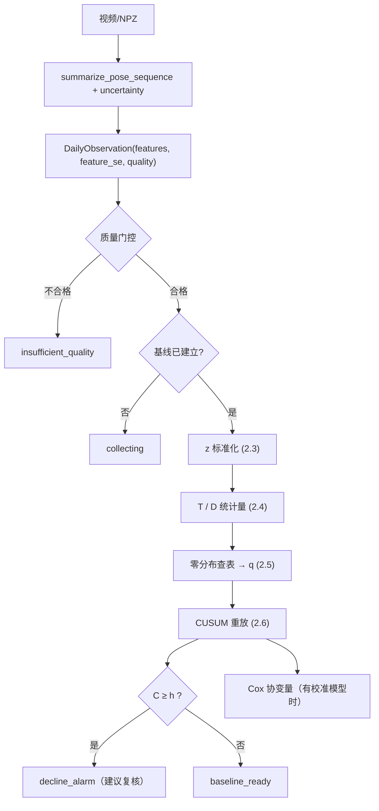

# DS-PCD：方向先验 + 测量误差感知的个人基线序贯偏离检验

> 实现文档 / 训练（标定）设计 / 数据设计 / 数据来源可行性结论
> 版本 v0.1（2026-11-13）　适用代码：`longitudinal/`

---

## 0. 结论速览

| 问题 | 结论 |
|---|---|
| 数据能否直接用 LLM 生成？ | **不能用于验证或任何性能结论。** 只能用于生成接口示例和测试夹具的文本；即便是这类用途，也建议改用确定性代码生成。§6 详述原因。 |
| 能否用论文数据验证并与论文结果对比？ | 本项目依据的 Mehdizadeh 2020（JAMDA）和 Adeli 2023（JBHI）**原始数据不公开**，属于住院痴呆患者数据，需要伦理审批和数据使用协议。即使拿到数据，也**不能**直接拿本方法的数字去比论文的 AUROC 0.80 / 0.762；正确做法是在同一数据、同一划分上**复现论文基线**再做配对比较。§7 详述。 |
| 现在就能做的真实数据验证 | ① 自采诱发步态扰动数据（主验证）；② 公开数据 TOAGA，用于复现论文的特征—临床量表相关性，校验特征提取；③ 公开 IMU 数据（DUO-GAIT、LTMM），只用于检验统计层。§5 详述。 |

---

## 1. 目标与边界

**验证的命题**：在误报率相同的前提下，DS-PCD 对个人步态退化的检出率高于、检出延迟短于现有的 RMS 规则（[deviation.py](../longitudinal/deviation.py)）。

**不验证的命题**：未来 7/30 天跌倒概率。这需要真实跌倒随访标签，属于 §4.4 的下游任务。

**与现有模块的关系**：DS-PCD 是 `deviation` 层的**可切换替代实现**，不修改质量门控、存储格式的已有字段，也不修改 Landmark Cox 的接口。

---

## 2. 算法规格

记号：个人 i，第 t 个有效观测日，特征 k ∈ {1..K}（K=11，即 `DEFAULT_CORE_FEATURES`）。

### 2.1 观测模型

$$x_{t,k} = \mu_k + \eta_{t,k} + \varepsilon_{t,k},\quad \eta_{t,k}\sim N(0,\tau_k^2),\ \varepsilon_{t,k}\sim N(0,s_{t,k}^2)$$

- μₖ：个人基线水平。
- τₖ²：真实的日间波动。
- sₜₖ：当次会话的**测量标准误**，由步级 bootstrap 估计（§3.2）。

### 2.2 基线估计（14 个有效日，DerSimonian–Laird 随机效应）

$$w_t=1/s_t^2,\quad Q=\sum_t w_t(x_t-\bar x_w)^2,\quad \hat\tau^2=\max\!\Big(\tau^2_{floor},\ \frac{Q-(n-1)}{\sum w_t-\sum w_t^2/\sum w_t}\Big)$$

$$\hat\mu=\frac{\sum x_t/(\hat\tau^2+s_t^2)}{\sum 1/(\hat\tau^2+s_t^2)},\qquad \mathrm{Var}(\hat\mu)=\Big(\sum\frac{1}{\hat\tau^2+s_t^2}\Big)^{-1}$$

稳健性措施：先剔除 |z| > 4 的基线日（用中位数/MAD 判断）再拟合，剔除的日期写入 `baseline.json` 的 `excluded_dates` 字段。

### 2.3 单日标准化

$$z_{t,k}=\frac{x_{t,k}-\hat\mu_k}{\sqrt{\hat\tau_k^2+s_{t,k}^2+\mathrm{Var}(\hat\mu_k)}}$$

### 2.4 方向先验的单侧 χ̄² 统计量

方向向量 d 由文献**预先固定，不从数据学习**（§4.2）：

| 特征 | dₖ | 依据 |
|---|---|---|
| gait_speed_proxy | −1 | 步速下降与跌倒相关 |
| cadence_spm | −1 | 同上 |
| step_time_mean_s | +1 | 同上 |
| step_time_cv | +1 | 步态变异性增大（Hausdorff 2001；Verghese 2009） |
| gait_asymmetry | +1 | 不对称增大 |
| stance_width_norm | +1 | 代偿性加宽步宽 |
| trunk_tilt_mean_deg | +1 | 躯干前屈 |
| trunk_sway_rms_deg | +1 | 躯干晃动增大 |
| aspect_ratio_cv | +1 | 姿态不稳 |
| emos_proxy | −1 | 稳定裕度下降（Mehdizadeh 2020） |
| aspect_ratio_mean | 0 | 无方向先验，按双侧处理 |

$$T_t=\sum_{k:d_k\neq0}\max(0,d_kz_{t,k})^2+\sum_{k:d_k=0}\tfrac12 z_{t,k}^2$$

另外保留一个双侧综合统计量 $D_t=\sum_k z_{t,k}^2$，作为“非典型异常”提示通道，用来覆盖方向先验之外的变化。

### 2.5 个人化零分布与正态分数

1. 用基线残差 $z^{base}$ 估计相关矩阵，并做收缩：$\hat R=\lambda I+(1-\lambda)R_{emp}$，λ 默认 0.5。
2. 用固定种子 `seed = hash(person_id, baseline_created_at)`，从 $N(0,\hat R)$ 抽 M=20000 次计算 T，得到零分布分位数表（保存 1000 个分位点）。
3. 计算 $p_t=1-\hat F_0(T_t)$，再转换为 $q_t=\Phi^{-1}(1-p_t)$，截断到 [−4, 6]。

分位数表写入 `baseline.json`，因此每次推理结果确定、可复现。

### 2.6 CUSUM 序贯累积

$$C_t=\max(0,\ C_{t-1}+q_t-k_{ref}),\quad C_0=0$$

- 报警条件：$C_t\ge h$。
- 默认 $k_{ref}=0.5$；h 按目标误报率标定（§4.3）。
- 报警后的状态处理：$C_t$ 不清零，继续累积；人工复核确认“无事件”后，可以手动重置。
- 缺测日不更新 $C$；连续缺测超过 7 天时，C 乘以 0.5 衰减（工程参数，写入配置）。

### 2.7 输出

```json
{
  "detector": "ds_pcd",
  "z": {"step_time_cv": 2.1, "...": 0},
  "T": 9.8, "p_value": 0.012, "q": 2.26,
  "cusum": 4.7, "cusum_threshold": 5.3,
  "omnibus_D": 18.4, "omnibus_p": 0.07,
  "top_contributors": ["step_time_cv", "gait_speed_proxy"],
  "alarm": false
}
```

---

## 3. 实现设计

### 3.1 文件改动清单

| 文件 | 改动 |
|---|---|
| `longitudinal/uncertainty.py`（新增） | 步级 bootstrap / 块 bootstrap，输出 `feature_se` |
| `longitudinal/pose_features.py` | 新增 `summarize_pose_sequence(..., with_uncertainty=True)`，在 `PoseSequenceSummary` 中加 `feature_se` 字段 |
| `longitudinal/schema.py` | `DailyObservation` 增加可选字段 `feature_se: dict[str,float]`，并做校验（有限、> 0） |
| `longitudinal/ds_pcd.py`（新增） | `fit_ds_baseline`、`standardize`、`chibar`、`null_table`、`cusum_replay` |
| `longitudinal/baseline.py` | `PersonalBaseline` 新增 `ds_pcd` 子对象（μ、τ²、Var(μ)、R、零分布分位数表、种子、excluded_dates），版本号 version=2 |
| `longitudinal/config.py` | 新增 `detector: Literal["rms","ds_pcd"]="rms"` 以及 `DsPcdConfig`（λ、k_ref、h、M、τ_floor、方向向量、缺测衰减） |
| `longitudinal/service.py` | `_post_baseline_deviations` 按 `detector` 分派；DS-PCD 从基线后的全部有效观测**重放** CUSUM（无状态、可复现） |
| `scripts/*.py` CLI | `collect_longitudinal.py` 增加 `--with-uncertainty`；`build_personal_baseline.py` 和 `predict_future_fall.py` 增加 `--detector ds_pcd` |
| `scripts/sim_ds_pcd.py`（新增） | 把现有 Stage-0 仿真脚本迁入项目，作为回归基准 |
| `scripts/eval_ds_pcd.py`（新增） | 真实数据评估（§4.3 嵌套 LOSO、§5.2 指标） |
| `tests/test_ds_pcd.py`（新增） | 见 §3.5 |

`config_fingerprint` 会自动纳入 `detector` 和 `DsPcdConfig`，防止新旧方法的基线混用。

### 3.2 测量标准误估计（uncertainty.py）

- **步相关特征**（cadence、step_time_mean/cv、asymmetry）：先用现有 `_step_events` 得到步事件，按**步态周期**（同侧相邻两次事件）切分；对周期有放回重采样 B=200 次，每次重算特征；SE 取重算结果的标准差。
- **帧相关特征**（speed、tilt、sway、stance、aspect、emos）：做**移动块 bootstrap**，块长等于中位步周期的帧数，保留帧间自相关；B=200。
- 周期数少于 8 时，SE 不估计，改用回退值（见下）。
- 回退模型：$s_k = c_k\sqrt{30/n_{steps}}$，其中 $c_k$ 在标定集上拟合（§4.3），存入 `model/longitudinal/ds_pcd_calib.json`。
- 外部设备只提供特征、不提供 `feature_se` 时，也使用回退模型。
- 复杂度：单个会话 30 秒、30 fps 时，B=200 的计算量约为 6000 次特征计算，numpy 向量化后预计不到 1 秒。

### 3.3 服务流程



新状态 `decline_alarm` 和原有的 `calibration_required` 并存，按 `detector` 二选一，接口文档需要同步更新。

### 3.4 向后兼容

- 默认 `detector="rms"`，现有测试全部不受影响。
- 旧的 `baseline.json`（version=1）在 `ds_pcd` 模式下拒绝加载，并提示重建基线。

### 3.5 测试

| 测试 | 断言 |
|---|---|
| DL 退化 | 所有 s=0 时，μ̂ 等于样本均值，τ̂² 等于样本方差（容差内） |
| 标准化 | 用已知参数仿真 1 万次，z 的均值约为 0、方差约为 1（±0.05） |
| 零分布 | R=I 时，T 的 MC 分位数与解析 χ̄² 混合分布一致 |
| 方向 | 只在先验方向上加偏移时 T 增大；反方向偏移时 T 基本不变 |
| CUSUM 重放 | 观测顺序固定时，两次运行输出逐字节一致 |
| 误报率回归 | `sim_ds_pcd.py` 零假设下 30 天误报率 ≤ 目标值 + 0.02 |
| 指纹 | 切换 `detector` 后，旧基线被拒绝 |
| bootstrap | 合成正弦步态加已知噪声时，SE 估计相对误差 < 20% |

---

## 4. 训练（标定）设计

DS-PCD 本身是统计检验，**没有需要梯度训练的参数**。“训练”指的是三类参数的确定方式。必须严格区分，否则会被质疑过拟合。

### 4.1 参数分层

| 层级 | 参数 | 确定方式 | 使用的数据 |
|---|---|---|---|
| 先验固定 | 方向向量 d、K 个特征 | 文献，写进预注册 | 不使用任何数据 |
| 人群标定 | h、k_ref、λ、τ_floor、c_k（SE 回退） | 在**标定受试者**的无扰动数据上调参 | 标定集 |
| 个人估计 | μ、τ²、Var(μ)、R、零分布表 | 每人自己的 14 天基线 | 本人基线 |
| 下游（有标签后） | Cox 系数 β、基线生存 S₀ | 偏似然 | 带随访标签的训练集 |

### 4.2 为什么 d 不从数据学

用扰动数据去学 d，再在同一批数据上评估，会把扰动类型直接“编码”进检测器，评估结果因此偏乐观。d 只在预注册阶段从文献确定。作为**敏感性分析**，可以另报一个用 LOSO 学到的 d 的结果，但它不作为主结果。

### 4.3 嵌套留一受试者（LOSO）标定流程

```text
for 每个测试受试者 s:
    标定集 = 其余受试者
    1) 在标定集的会话上拟合 c_k（log s ~ log n_steps 回归）
    2) 在标定集上构造“无扰动监测序列”（14 天基线 + 30 天正常会话，日序可置换重采样）
    3) 网格搜索 h，使 30 天内至少一次误报的概率 ≤ 10%；k_ref ∈ {0.25, 0.5, 1.0}，λ ∈ {0.3, 0.5, 0.7}
       选择规则：先满足误报率约束，再最大化标定集上的平均检出率（只用标定集的扰动数据）
    4) 固定这些参数，在受试者 s 上评估：
       - 零误报率：只含正常会话的监测序列
       - 检出：正常会话 + 扰动会话段
```

对照方法 A1（现有 RMS 规则）走**完全相同**的流程：它的阈值也在标定集上按同一误报率调。这一点是比较能否经得起推敲的关键。

### 4.4 下游 Landmark Cox（有真实随访标签时）

- **Landmark 数据集**：每个有效观测日 t 是一个预测时点，协变量包括 $C_t$、$T_t$、$\max_{t-6..t}q$、$D_t$，以及已有的 `distance`、`trend_7d`；结局是 [t, t+H] 内首次跌倒，H 取 7 或 30；随访结束则截尾。同一人的多个 landmark 用稳健（sandwich）方差处理。
- **对照**：同一数据上用现有协变量（distance、trend_7d、persistent_deviation_days）拟合 Cox。
- **指标**：时间依赖 AUROC(H)、Brier(H)、校准斜率；按受试者聚类 bootstrap 求 ΔAUROC 的 95% CI。
- **验证**：LOSO，或者在另一机构/另一时段做外部验证；`calibrated=true` 只能由独立验证结果来设置，与现有流程一致。

---

## 5. 数据设计

### 5.1 数据分层

| 层 | 数据 | 能验证什么 | 不能验证什么 |
|---|---|---|---|
| D0 | 参数化仿真（代码生成，已有脚本） | 统计性质：误报率控制、各组件的消融 | 任何真实性能 |
| D1 | **自采：诱发步态扰动（主验证）** | 真实单目视频条件下，步态变化的检出率、延迟、误报率，以及特征信度 | 老人的自然退化、跌倒预测 |
| D2 | TOAGA（公开，老年人视频 + 姿态 + 临床量表） | 特征提取流程与临床量表的相关性，可与论文报告的相关系数对照 | 纵向变化检出（需下载后核实是否有多日重复） |
| D3 | DUO-GAIT / LTMM（公开，IMU） | 只验证统计层（DL + χ̄² + CUSUM）在独立数据上的行为 | 视觉流程 |
| D4 | 论文原始数据（受限） | 与论文基线做同数据配对比较 | 需要数据使用协议，周期以月计 |

### 5.2 D1 采集协议

**受试者**：8 名成年志愿者（目标 ≥ 6 人可分析）。签知情同意，视频本地存储，只上传姿态数据。

**设备**：项目现有摄像头，机位、高度、角度固定并拍照存档。直线通道长度 ≥ 8 m，侧向或斜 45° 视角（与部署时一致）。光照记录为协变量。

**会话**：每个会话包含 4 趟往返步行，每趟不少于 8 m，自选舒适速度；目标每会话有效步数 ≥ 40。

| 阶段 | 会话数 | 条件 |
|---|---|---|
| 基线 | 14 | 正常步行，≥ 10 个不同日期（每天最多 2 次，间隔 ≥ 4 小时） |
| 正常监测 | 10 | 正常步行，用于零误报率评估 |
| 扰动 P1 | 5 | 双任务：边走边做连续减 7 |
| 扰动 P2 | 5 | 单侧踝部负重 2–3 kg |
| 扰动 P3 | 5 | 单侧护膝限制屈膝（约 20–30°） |

- 扰动会话和正常监测会话按区组随机交错，避免学习效应和时间趋势与扰动混淆。
- 分析人员对条件标签设盲：标签单独存放，评估脚本最后才合并。
- 每人约 39 个会话、3–4 周；单个会话约 5 分钟。

**监测序列构造**：受试者的各会话之间视为独立的“日”。

- 零误报率序列：14 个基线会话 + 10 个正常会话的置换。
- 检出序列：14 个基线会话 + k 个正常会话 + 该类扰动的 5 个会话，k ∈ {0..5} 随机。

这是一种“拼接”设计，必须在报告中如实说明。它测的是**突发型**变化的检出；渐进型变化只能用 D0 仿真或自然纵向数据补充。

**样本量估算**：主终点是配对检出率（McNemar 检验）。预期不一致比例 p₁₀=0.45、p₀₁=0.05（参照 D0 仿真中 A4 对 A1 的差距，取保守值），α=0.05，功效 0.8，需要约 22 个检出事件；考虑受试者聚类，设计效应取 1.5，需要约 33 个。8 人 × 3 种扰动 × 2 个独立序列 = 48 个，满足要求。

**目录与清单**：

```text
data/ds_pcd_d1/
  manifest.csv           # person_id, session_id, date, time, condition(blinded_code), camera_id, lux, notes
  conditions_key.csv     # blinded_code -> {normal, P1, P2, P3}（分析人员不可见，最终评估才合并）
  pose/<person>/<session>.npz      # landmarks, visibility, timestamps（与 pose_cache 同格式）
  daily/<person>/<session>.json    # summarize_pose_sequence(with_uncertainty) 输出
```

**主要终点（预注册）**：误报率对齐（30 天至少一次误报的概率 ≤ 10%）时，扰动段在 5 个会话内的检出率，比较 A4（DS-PCD）与 A1（RMS，同流程调阈值）。

**次要终点**：
- 检出延迟（会话数）；
- 会话级 AUROC（正常 vs 扰动，统计量取 T 或 RMS 距离）；
- 实测零误报率；
- 各特征的 ICC(3,1)、SEM、MDC95，比较 bootstrap 精度加权前后；
- 消融 A1→A2→A3→A4，回答“精度加权”在真实数据中是否有增益（D0 仿真中这一步增益不明确，因此这是开放问题）。

### 5.3 D2：TOAGA

Mehdizadeh 等，Scientific Data 2022，Figshare 公开。据公开描述：14 名老年人，60 秒步行段，提供 AlphaPose/OpenPose/Detectron 的 2D 下肢关节、IMU 3D 关节，以及 POMA、BBS、TUG 量表。

- **用途 1：复现论文结果。** 用本项目流程计算时间类特征（cadence、step_time），再与 POMA、BBS、TUG 求相关，对照论文报告的结论“时间类变量相关高，空间与变异性变量相关低”。这是“和论文结果对比”的合规方式：数据相同、指标相同。
- **用途 2：标定 SE 回退系数。** 用同一人多个步行段的离散程度，估计 c_k（如果数据确有同人重复段）。
- **限制**：只有下肢关节。本项目依赖肩部和鼻部的特征（trunk_tilt、shoulder_width 归一化、emos_proxy）无法计算，需要改用髋宽或腿长归一化的适配版本。是否包含原始视频、是否有多日重复，**以下载后核实为准**。

### 5.4 D3：IMU 公开数据（只验证统计层）

- **DUO-GAIT**（Zenodo）：健康成人单任务和双任务步行的多部位 IMU 数据。把单任务当作基线、双任务当作“扰动”，检验 DS-PCD 统计层的检出能力与误报率控制。传感器不同，结论只适用于统计层。
- **LTMM**（PhysioNet）：71 名社区老人，3 天腰部加速度计数据，按跌倒史分组（回顾性）。天数太少，做不了纵向检验；只能用于横断面评估特征区分度，作为补充材料。

---

## 6. 能否用 LLM 生成数据？

**结论：不能用于验证、训练或任何性能结论。** 原因如下：

1. **没有生理真值。** LLM 输出的数字来自文本统计规律，不来自步态生物力学和测量过程。在这样的数据上检出率高，只说明方法适应了 LLM 的输出习惯。
2. **循环论证。** 数据生成方式由提问者的提示词决定。方法设计者让 LLM“生成会跌倒的老人的步态数据”，等于把自己的假设写进数据，再用数据去证实假设。
3. **数值分布不可控。** 相关结构、异方差、重尾、日间自相关等统计性质都无法保证，也无法复现：同一提示词，不同版本或不同采样温度会给出不同结果。
4. **审稿与答辩无法通过。** 医学和信号处理领域普遍不接受以 LLM 合成数据作为验证依据。
5. **参数化仿真（D0）已经覆盖了“已知真值”的用途**，而且更好：生成机制透明（公式、参数全部公开）、可复现（固定种子）、可做敏感性分析。D0 的定位是“方法性质检查”，同样不能当作实证结果。

**允许的用途（不进入任何结果表）**：生成接口文档里的 JSON 示例、生成 schema 校验的边界用例思路、润色采集协议的文字。即使是测试夹具，也建议用确定性代码生成（例如 `tests/` 里的固定种子 numpy 数据），不用 LLM 直接写数字。

---

## 7. 能否用论文数据验证并与论文结果对比？

### 7.1 数据可得性

| 论文 | 数据 | 可得性 |
|---|---|---|
| Mehdizadeh 2020 JAMDA（7/30 天，AUROC 0.80/0.67） | 多伦多康复研究所痴呆病房，Kinect 走廊步态 + 用药 + 临床记录 | **受限**，需经 UHN/KITE 伦理委员会审批并签数据使用协议，向通讯作者申请 |
| Adeli 2023 JBHI（4 周，AUROC 0.762） | 54 名长期照护痴呆老人，环境视觉步态 + 用药 + 临床 | **受限**，同上 |
| TOAGA 2022 Sci Data | 14 名老年人步行视频衍生姿态 + IMU + 量表 | **公开**（Figshare） |

### 7.2 为什么不能直接比数字

“我们的 AUROC X 对比 Mehdizadeh 的 0.80”在以下任一项不同时都不成立：人群（痴呆住院患者 vs 社区或健康人）、传感器（Kinect 3D vs 单目 RGB）、结局定义与时间窗、样本量与事件数、验证方式（LOSO vs 时间外推）、协变量（论文含用药和临床量表）。这些项目全都不同，因此论文数字只能作为**背景参照**，不能作为基线。

### 7.3 合规的对比方式

1. **拿到 D4 数据时**：在同一数据、同一 LOSO 划分上，①按论文描述复现其模型（eMOS + 跌倒史的 Cox）；②把 DS-PCD 协变量加入或替换后重新拟合；③报告 ΔAUROC(7 天/30 天)、ΔBrier、校准斜率，以及聚类 bootstrap 95% CI。复现结果与论文报告值的差距也应一并报告，作为复现可信度的证明。
2. **只有公开数据时**：在 TOAGA 上复现论文的“特征—量表相关性”表，作为**特征提取层**的对比；DS-PCD 的增益只在 D1 上以配对方式报告。
3. **论文写法建议**：“与文献报告值（不同人群与传感器，不可直接比较）相比……”，避免把文献数字放进同一张对比表。

### 7.4 申请论文数据的建议路径

1. 联系通讯作者 Andrea Iaboni / Babak Taati（KITE–UHN），附研究计划、伦理批件和数据安全措施。
2. 优先申请**去标识化的派生特征表**（每次步行的步态参数 + 跌倒日期），而不是原始视频，获批概率更高。
3. 预计周期 3–6 个月以上，不应放在当前里程碑的关键路径上。

---

## 8. 里程碑与验收标准

| 里程碑 | 内容 | 验收 |
|---|---|---|
| M1（1 周） | `ds_pcd.py`、`uncertainty.py`，schema/config 扩展，单元测试 | §3.5 全部通过；`detector=rms` 时既有测试零回归 |
| M2（0.5 周） | `sim_ds_pcd.py` 入库作为回归基准 | 零误报率 ≤ 0.12；结果与 Stage-0 报告一致（±3%） |
| M3（3–4 周） | D1 采集 + 预注册（在采集开始前冻结 §5.2 的终点与分析脚本） | ≥ 6 人完成，有效会话率 ≥ 85% |
| M4（1 周） | `eval_ds_pcd.py` 嵌套 LOSO 评估，消融 A1–A4 | 输出主、次要终点及 95% CI；无论结果正负都如实报告 |
| M5（并行） | TOAGA 复现；申请 D4 | 复现相关性方向与论文一致，或给出差异分析 |

> 报告原则：主终点在采集前固定；精度加权（A2）在仿真中增益不明确，作为开放问题对待；所有结论注明数据层级（D0/D1/D2）。
