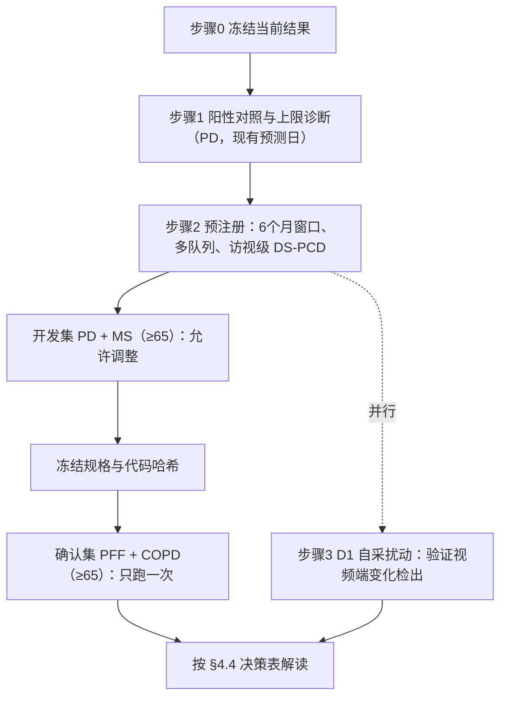

# DS-PCD 阶段复盘与下一步（Mobilise-D 30 天结果之后）

> 日期：2026-11-14　目标不变：验证 DS-PCD 能否作为“提升长期跌倒预测效果”的可量化创新点
> 依据：`output/ds_pcd_mobilise/20261114-fixed/report.md`、`stage2/REPORT.md`、`stage3/REPORT.md`，以及本次对 Mobilise-D 原始包的核查

---

## 1. 对现有结果的判断

**结论：这次实验没有回答“DS-PCD 能否提升跌倒预测”。它不是负结果，而是检验力不足、对照模型本身没有信号的无信息结果。** 原因有四点，前两点属于设计问题，事前就能算出来。

### 1.1 检验力：只能检出 ΔAUROC 约 0.19 以上的增益

16 个阳性时，ΔAUROC 的 95% CI 半宽约 0.13，对应的标准误约 0.067。按 80% 功效计算，最小可检出差值约为 2.8 × 0.067 ≈ **0.19**。单个协变量带来 0.19 的 AUROC 增量，在跌倒预测文献里几乎不存在。因此无论 DS-PCD 是否有效，这个设计大概率都会给出“区间跨 0”。

### 1.2 对照模型 A 的 AUROC 为 0.499，校准斜率 −0.17

A（只用 RMS 距离）对 30 天跌倒没有区分能力。在“零信号”模型上检验“增量”，问题本身就不成立。更关键的是，实验**缺少阳性对照**：没有检查跌倒史、年龄、绝对步速这些已知预测因子，在这条预测日 → 结局的流程上能否得到预期的 AUROC（帕金森人群中跌倒史通常在 0.7 左右）。如果连跌倒史都接近 0.5，问题出在结局、窗口或选样，而不在 DS-PCD。

### 1.3 构念错位：DS-PCD 在这份数据里被削弱了

- **CUSUM 失效**：仿真中，增益主要来自方向先验和**跨 3–4 周的序贯累积**。Mobilise-D 每半年一次访视、每次 5–9 天，CUSUM 遇到超过 7 天的空档就重置（77 次）。预测日之前已评分的监测日中位只有 7 天，因此 C 约等于一周内的 q 之和，序贯优势在结构上无法发挥。
- **方向检验退化**：只有 3 个特征（步速、步频、跨步周期），而步频和跨步周期近似互为倒数，方向 χ̄² 实际上退化成一维的“变慢”检验。仿真里方向先验的优势来自多维、稀疏的退化，这里同样无法体现。
- **时间尺度不对应**：基线结束到预测日中位相隔 184 天，30 天窗口检验的是“本周相对半年前的偏离能否预测接下来 30 天”。这个衔接假设本身没有被单独验证过。

### 1.4 已经出现分叉路径风险

到目前为止已经有：旧版 vs 修正版、186 vs 172 个预测日、session_se vs none（none 给出 +0.078）、S14 vs S7 扩样。**不能挑选其中任何一个点估计作为证据。** 继续在 PD 的 30 天数据上换口径重跑，只会增加假阳性风险。

## 2. 对现有结果的处理

1. **冻结并如实报告**：判定写成“证据不足（检验力不足；对照模型无信号；未设阳性对照）”，同时报告最小可检出差值约 0.19，并注明可以排除 ΔAUROC > +0.126。
2. **不再在 PD 30 天数据上换口径重跑。** session_se 和 none 都保留为既定敏感性分析，不切换主分析。none 看起来更好，这与仿真中“精度加权的增益不明确”一致，留到新研究里作为预注册消融处理。
3. **对外表述**：DS-PCD 已完成工程实现，统计层的性质已经验证；跌倒预测增益**尚未检验充分**，不写作“无效”，也不写作“有效”。

## 3. 关键新发现：Mobilise-D 里有一个大约 75 倍事件量的结局

核查原始包（Data Dictionary 的 `Conflicting variables` 页）后确认：

| 变量 | 访视 | 队列 | 问题 |
|---|---|---|---|
| `fallhistyr` / `fallnumyr` | T1 | 全部 | 过去 12 个月是否跌倒 / 次数 |
| `fallshist` / `fallsnum` | T2–T5 | **全部** | 过去 6 个月是否跌倒 / 次数 |
| `fallstotal` | T2–T5 | PD、MS | 日记记录的 6 个月跌倒总数 |

65 岁及以上、T2–T5 中 `fallsnum > 0` 的访视统计：

| 队列 | ≥65 岁人数 | 访视记录 | 有跌倒的访视 | 有跌倒的人 |
|---|---:|---:|---:|---:|
| PD | 341 | 1,089 | 390 | 193 |
| PFF（髋部骨折后） | 459 | 1,323 | 513 | 354 |
| COPD | 402 | 1,169 | 162 | 119 |
| MS | 71 | 242 | 136 | 54 |
| **合计** | **1,273** | **3,823** | **1,201** | **720** |

当前 30 天主分析只有 16 个阳性。改用 **“访视 k 的步态 → 访视 k+1 报告的未来 6 个月内跌倒”**，事件量提高约两个数量级。这个设计同样是“预测未来一个时间窗口内的跌倒”，并且时间尺度和 DS-PCD 的“长期画像”一致。PFF 是髋部骨折后的老年人，与项目的目标人群（居家老人跌倒）最接近。

需要说明的限制：
- 6 个月回忆式自报存在回忆偏倚。
- 步态采集周位于结局窗口的开头。
- 结局用 `fallshist` 的二分类；`fallsnum` 用作次数的次要结局。
- 以上计数还没有扣除步态覆盖和基线条件，实际可用量需要重建队列后确认。

## 4. 下一步：把“方法问题”和“数据问题”拆开

### 4.1 步骤 1：阳性对照与上限诊断（约 1 天，只做诊断，不加 DS-PCD）

在现有 PD 的 186 个预测日上，用同一分折方式分别评估：

- M0：跌倒史（`fallhistyr`，或上一访视的 `fallstotal`）；
- M0 + 年龄；
- M0 + 绝对步速水平。

解读：
- 如果 M0 的 AUROC 明显高于 0.5（预期在 0.65 以上），说明流程正常，30 天上的问题是“个人偏离本身信号弱”加上“事件太少”。
- 如果 M0 也接近 0.5，先排查结局、窗口和选样，然后才能评价 DS-PCD。

### 4.2 步骤 2：预注册的确认性研究（核心）

**设计**
- 人群：Mobilise-D CVS 中 65 岁及以上的 PD、MS、PFF、COPD 受试者。
- 预测时点：访视 k 结束后的步态采集块。
- 基线：至少 2 个更早访视的采集块，严格早于预测时点。
- 结局：访视 k+1 的 `fallshist`（未来约 6 个月内是否跌倒）。
- 划分：
  - 开发集为 PD 和 MS。PD 的 30 天数据已经被看过，只能算探索性；允许在开发集上调整特征和参数。
  - 确认集为 PFF 和 COPD，在冻结规格之前**完全不接触结局**。冻结后只运行一次，主结论以确认集为准。
  - 两组都按人分折。

**访视级 DS-PCD（把方法适配到这份数据的时间结构）**
- 观测单位从“天”改为“访视块”：块均值作为观测，块内日间离散度给出块标准误。块内只有 5–9 天，测量误差感知在这里有实际意义。
- 序贯累积跨访视进行，不因空档重置；空档就是正常的采样间隔。
- 用逐段表（Walking Bout DMO，约 955 MB）扩展特征，按方向先验预先登记：
  - 步速 P90（Mobilise-D 推荐的真实世界步速指标）；
  - 跨步长度；
  - 日内跨步周期的段间变异；
  - 每日步行段数和步行总时长（活动量）。
  这样可以恢复方向检验需要的多维结构。

**对照阶梯（全部在同一行集合上拟合）**

| 模型 | 协变量 |
|---|---|
| M0 | 年龄 + 队列 + 既往跌倒史 |
| M1 | M0 + 当前访视的绝对步态水平 |
| M2 | M1 + 朴素变化量（当前块均值减基线均值，每个特征一项） |
| M3 | M2 + DS-PCD（访视级 T 与跨访视 C） |

**主要终点**：M3 相对 M2 的似然比检验（DS-PCD 项是否提供朴素变化之外的信息）。

依据 Pepe 等（2013）：嵌套模型比较应检验新增协变量，ΔAUROC 检验既不敏感、性质也有问题。

**次要终点**：
- ΔAUROC、ΔBrier、校准斜率，按人聚类 bootstrap 给出 95% CI；
- 按队列分层的结果；
- 以 `fallsnum` 为结局的次数模型（负二项回归）。

**检验力粗估（需在重建队列后复算）**：假设确认集约 1,000 个预测时点、约 300 个事件，ΔAUROC 的标准误约 0.01–0.015，最小可检出差值约 0.03–0.04。一个协变量 OR 为 1.2/SD 时，似然比检验的功效大于 0.8。这已经足以回答问题，结果无论正负都可以报告。

**消融（预注册，次要）**：session_se vs none；只用方向 T vs 方向 T 加 C；3 特征 vs 扩展特征。

**仍保留的分析**：PD 的 7/30 天日记结局作为短窗口次要分析，只做描述性报告。

### 4.3 步骤 3：D1 自采扰动实验（与步骤 2 并行，见 `DS-PCD_实现与验证设计.md` §5.2）

Mobilise-D 使用的是腰部 IMU，没有摄像头，也没有“已知的真实变化”。它能验证统计层和“步态变化 → 跌倒”这一环，**不能**验证视频端的变化检出能力。D1 负责后半段：在误报率对齐的条件下，比较视频流程的检出率。两部分合起来，才构成“摄像头画像 → 变化检出 → 跌倒预测”的完整证据链。

### 4.4 决策表（预注册，用来区分数据问题和方法问题）

| M1 vs M0 | M2 vs M1（朴素变化） | M3 vs M2（DS-PCD） | 解读与动作 |
|---|---|---|---|
| 有增益 | 有增益 | **有增益** | DS-PCD 作为跌倒预测创新点**成立**（限定人群：确认集队列） |
| 有增益 | 有增益 | 无增益 | 步态变化能预测跌倒，但 DS-PCD 不比朴素变化好：**方法问题**。创新点退回为“变化检出方法”，以 D1 结果为准 |
| 有增益 | 无增益 | 无增益 | 个人变化在 6 个月尺度上不携带额外信息：**目标衔接问题**。长期预测应以绝对水平为主，DS-PCD 定位为监测和告警工具 |
| 无增益 | — | — | 这份数据中步态与跌倒的关联弱，或者结局有问题：**数据问题**。DS-PCD 在本数据上不可评估 |

所有判定以确认集上的似然比检验 p < 0.05，并且 ΔAUROC 的点估计方向一致为准；开发集结果只用于定方案。

## 5. 里程碑

| 步骤 | 内容 | 预计 | 出口条件 |
|---|---|---|---|
| 0 | 冻结报告，补上最小可检出差值和“无阳性对照”的说明 | 0.5 天 | 报告更新完毕 |
| 1 | 阳性对照与上限诊断 | 1 天 | 得到 M0、M0+年龄、M0+步速的 AUROC 及区间 |
| 2a | 多队列 6 个月队列重建（`fallshist` 连接、访视块、基线条件），给出流程图和事件数 | 2–3 天 | 实际事件数与检验力复算；若确认集事件少于 150，回到设计 |
| 2b | 开发集上实现访视级 DS-PCD 并扩展特征，冻结规格（哈希写入预注册） | 3–4 天 | 预注册文件提交 |
| 2c | 确认集一次性运行 | 1 天 | 按 §4.4 给出判定 |
| 3 | D1 自采（并行） | 3–4 周 | 见实现与验证设计 §8 |
