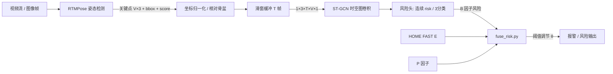

# RTMPose + ST-GCN 跌倒风险预测 —— 设计文档

> 分支：`feature/rtmpose-stgcn-fall-risk`（从 `main` 拉取）
> 范围：**仅设计文档，不含任何实现代码**
> 目标：用 **RTMPose** 替换现有 MediaPipe Pose 提点，用 **ST-GCN（时空图卷积网络）** 替换现有 LSTM，构成下一代「B 因子（姿态风险）」子模型；保留现有 B/E/P 三因子融合与阈值调节范式不变。

---

## 1. 背景与目标

### 1.1 现状
当前系统「B 因子」链路为：`MediaPipe Pose Landmarker` 提 33 关键点 → `FrameFeatureBuilder` 构造 29 维特征 → `SlidingWindowBuilder` 切 35 帧窗 → `RiskRegressor`/`FallLSTM`（2 层 LSTM, hidden=64, dropout=0.3）输出连续风险 / 3 分类。

该链路有两点瓶颈：
1. **关键点质量依赖 MediaPipe**，对遮挡、远距离、俯仰视角鲁棒性有限；
2. **LSTM 只建模时间维度**，未显式建模「关节—关节」的空间拓扑（骨骼结构），对姿态/动作语义的利用不充分。

### 1.2 本构建目标
- **RTMPose**：更高精度、更高速度的人体关键点检测（OpenMMLab MMPose），输出结构化骨架。
- **ST-GCN**：在「骨架图」上同时做**空间图卷积 + 时间卷积**，天然契合「人体是一张图、动作是图随时间的演化」，比 LSTM 更贴合跌倒/失衡的时空模式。
- 输出仍对齐现有体系：连续风险 `risk∈[0,1]`（对齐 `RiskRegressor`）与/或 3 分类 `Normal/Unstable/Fall`（对齐 `v5_w35`）。
- **不改动** B/E/P 融合与阈值调节（`scripts/fuse_risk.py` 直接复用）。

### 1.3 不在本次范围
- 不写任何训练/推理代码；
- 不训练模型、不准备数据集（仅给出数据集改造方案）；
- 不改动 E（HOME FAST）、P（生理）因子。

---

## 2. 系统总体架构



- 新链路只替换图中 `POSE → NORM → BUF → STGCN → HEAD` 这一段（即 B 子模型）。
- `FUSE / ENV / PHY / OUT` 完全复用现有实现。

---

## 3. 模块划分

| 模块 | 职责 | 复用 / 新建 |
|------|------|------------|
| `pose/rtmpose_detector.py` | 封装 RTMPose，输入帧 → 关键点+bbox+conf | **新建** |
| `features/skeleton_norm.py` | 坐标归一化（相对骨盆中心、按躯干长度缩放）、置信度处理 | **新建**（替代 `feature_builder` 的 29 维工程） |
| `sequence/keypoint_buffer.py` | 维护滑窗，输出 `(T,V,3)` 张量 | **新建**（替代 `dataset_builder` 的 29 维滑窗） |
| `model/stgcn/*.py` | 图拓扑定义 + ST-GCN 单元 + 风险头 | **新建** |
| `model/stgcn/graph.py` | 按 RTMPose 关键点顺序定义骨骼邻接图 | **新建**（关键，见 §6.3） |
| `demo/demo_stgcn.py` | 实时演示入口（替换 `demo.py` 的 pose+model 调用） | **新建** |
| `scripts/fuse_risk.py` | B/E/P 融合与阈值调节 | 复用 |
| `model/env/env_risk_model.py` | HOME FAST（E） | 复用 |
| `scripts/build_config.py` | 超参事实源（新增 ST-GCN 相关项） | 扩展 |

> 设计原则：**ST-GCN 直接吃原始关键点 `(T,V,3)`，不再手工构造 29 维特征**（速度/角度等由图卷积自动学习）。因此现有 `features/feature_builder.py`、`datasets/dataset_builder.py` 在本构建中**退场**，仅保留其滑窗/缓冲思路。

---

## 4. 数据流向（Pipeline 详述）

1. **采集**：单帧 RGB（摄像头 / 视频文件 / RTSP 流）。
2. **检测**：RTMPose 输出 bbox + `V` 个关键点 `(x, y, conf)`，坐标归一化到 `[0,1]`（图像相对）。
3. **单人聚焦 + 跨帧 ID 绑定**（时序命门）：跌倒是强时序任务，滑窗 T=60 内必须始终是**同一目标**的连续骨架，ID 跳变 = 窗口作废。复用 MMPose `PoseTracker`（链路：**RTMDet 检测框 → RTMPose 关键点 → ByteTrack 关联**）逐帧输出带 `track_id` 的骨架；注意 RTMPose 本身不自带 track，须串入 RTMDet。主目标采用 **lock-and-switch**：首帧按「面积最大 且 conf 达标」选定 `primary_id` 后持续跟随，仅当其连续丢失 > K 帧（对齐 ByteTrack `track_buffer`）才重选，避免逐帧 argmax 的 ID 抖动；多人默认只跑 `primary_id`，可选每人各跑一条风险流。
4. **坐标归一化**（`skeleton_norm`）：
   - 平移：各关节减「左右髋中点（骨盆中心）」；
   - 缩放：除以躯干长度（颈—骨盆距离）；
   - 通道：保留 `(x, y, conf)` 三通道，conf 兼作遮挡掩码。
5. **滑窗缓冲**（`keypoint_buffer`）：维护长度 `T` 的环形缓冲，每新到一帧 push 并弹出最旧帧；满窗后产出 `(T, V, 3)`。
6. **张量化**：reshape 为 `(N=1, C=3, T, V, M=1)`。
7. **ST-GCN 推理**：时空图卷积 → 全局池化 → 风险头。
8. **输出 B 风险**：连续 `risk` 或 3 分类 logits。
9. **融合**：送入 `fuse_risk.py`，与 E、P 做阈值调节（E/P 只调 `θ_alarm/θ_warn`，不进风险分）。
10. **报警**：按调节后阈值输出 WARNING / DANGER。

**延迟预算（实时目标）**：RTMPose 检测 ~5–15 ms（GPU, tensorrt），ST-GCN 推理 < 5 ms（轻量图网络），端到端单帧 < 25 ms，满足 ≥ 30 fps。

---

## 5. 接口定义（模块间契约）

> 以下为**接口规格（signature）**，非实现。

### 5.1 RTMPose 检测接口
```
detect(frame: np.ndarray) -> PoseResult
PoseResult:
    keypoints : np.ndarray  shape (V, 3)   # x,y ∈ [0,1], conf ∈ [0,1]
    bbox      : tuple                       # (x1,y1,x2,y2) 图像坐标
    score     : float                       # 整体检测置信度
```

### 5.2 归一化接口
```
normalize(keypoints: (V,3), pelvis: (2,), torso_len: float) -> (V,3)
# 输出: 相对骨盆、按躯干长度缩放后的 (x,y,conf)
```

### 5.3 滑窗缓冲接口
```
buffer.push(frame_kp: (V,3)) -> Optional[np.ndarray]
# 返回 None 表示窗口未满；满窗返回 (T, V, 3)
```

### 5.4 ST-GCN 模型接口
```
stgcn.infer(window: (1,3,T,V,1)) -> RiskOutput
RiskOutput:
    risk  : float            # ∈ [0,1] 连续风险（sigmoid 头）
    logits: np.ndarray       # (3,) 三分类（softmax 头），可选
```

### 5.5 与融合层对接
- 直接复用 `fuse_risk.fuse(B=risk, E=homefast_E, P=physio_P)`，输入/输出契约不变。

---

## 6. 模型输入输出规范

### 6.1 RTMPose 规范
| 项 | 说明 |
|----|------|
| 来源 | OpenMMLab MMPose，`rtmpose` 系列 |
| 变体 | `rtmpose-t / s / m / l`（tiny→large，精度↑速度↓） |
| 关键点集 | 采用 **body+foot 26 关键点（HALPE-26）**；剔除面部 5 点（鼻/左眼/右眼/左耳/右耳）后 **V=21**，保留脚部 9 点（详见 §6.1.1） |
| 输入 | RGB 帧，推荐短边 256~384 |
| 输出 | 关键点 `(V,3)` + bbox + score；可选 wholebody（133 点，含脸/手，本场景不必要） |
| 部署 | MMDeploy 导出 ONNX/TensorRT；边缘可用 `rtmpose-t` |

#### 6.1.1 选定关键点集（本构建采用）
- **采用 RTMPose `body+foot 26`（HALPE-26 标准）**：26 点 = COCO-17 身体点 + 9 个脚部点（左/右 脚尖 big toe、小趾 small toe、脚跟 heel ×2，及 3 个脚部补充点）。
- **剔除面部 5 点**（nose 鼻、left_eye 左眼、right_eye 右眼、left_ear 左耳、right_ear 右耳）→ **V = 21**。
- **保留脚部 9 点**：绊倒/滑倒/步态节律信号集中在脚，对跌倒风险最关键，故保留。
- 为什么去面部：面部点定位噪声大、对跌倒无贡献，保留只为冗余；剔除后图更小、训练更稳。
- 通道 `C=3`：仅 `(x, y, conf)`，**先不加**速度/角度等手工特征；后续实验需要时直接把算好的速度/角度拼作额外通道（`C>3`，原始坐标仍保留）。
- 模型版本：`rtmpose-m`（medium，HALPE-26）起步，精度不足换 `rtmpose-l`（large）。

### 6.2 ST-GCN 输入张量
| 维度 | 含义 | 取值 |
|------|------|------|
| N | batch | 1（实时）/ 批量（训练） |
| C | 通道 | 3 = (x, y, conf) |
| T | 时间窗（帧） | **默认 60**（@30fps ≈ 2s），覆盖 ≥1 个步态周期 + 跌倒瞬态；可调 45~90 |
| V | 关节数 | **21**（body-26 去面部 5 点，本构建采用）或 26（body+foot 全量），须与图拓扑一致 |
| M | 人数 | 1（单人聚焦后） |

> 与现有 LSTM 方案对比：LSTM 吃 `(N,35,29)` 人工特征；ST-GCN 吃 `(N,3,T,V,1)` **原始骨架**，把特征工程交给图卷积。

### 6.3 ST-GCN 图拓扑（关键设计点）
- 邻接图 `A` 由所选关键点集的**骨骼连接**定义（本构建用 **body-26 去面部 = 21 点**：颈—肩—肘—腕、颈—髋—膝—踝—脚；鼻/眼/耳已剔除，脚部 9 点纳入边表）。
- 空间划分策略沿用 ST-GCN 原文：**root / centripetal（向心）/ centrifugal（离心）** 三类子图分区，分别做图卷积再求和。
- `model/stgcn/graph.py` 须**严格对齐 RTMPose 关键点顺序**（不同关键点集的边表不同），这是本构建最易出错处。**具体 21 点边表、重映射规则、三分区 hop 表见 `docs/RTMPose_STGCN_图拓扑边表.md`**（实现事实源）。
- 时间维：每个 ST-GCN 单元含「空间图卷积 + 时间卷积（kernel=9，逐步 stride 下采样）」，堆叠 9 个单元。

### 6.4 ST-GCN 风险头（输出）
- **回归头**（对齐 `RiskRegressor`）：`Linear(h,1) + sigmoid` → 连续 `risk∈[0,1]`。
- **分类头**（对齐 `v5_w35`）：`Linear(h,3) + softmax` → `Normal/Unstable/Fall`。
- **多任务（推荐）**：共享骨干 + 双头，损失 `L = λ·BCE(risk) + (1−λ)·CE(cls)`，推理时同时给类别与连续风险（复用现有 `RiskMultiTask` 思路）。

### 6.5 与现有 LSTM 方案对比
| 维度 | 现有（MediaPipe+LSTM） | 本构建（RTMPose+ST-GCN） |
|------|------------------------|---------------------------|
| 提点 | MediaPipe Pose | RTMPose（更高精度/速度） |
| 特征 | 人工 29 维（速度/角度/骨架） | 原始骨架 `(T,V,3)`，图卷积自动学 |
| 时序建模 | LSTM（仅时间） | 时空图卷积（空间拓扑+时间） |
| 输入尺寸 | (N,35,29) | (N,3,T,V,1) |
| 空间结构 | 隐含（靠坐标顺序） | 显式骨骼图 |
| 融合 | B/E/P 阈值调节 | 同左（B 风险来源替换） |

---

## 7. 数据集改造方案（实现阶段执行）

- 现有 `datasets/experiment/*/X_*.npy` 是 **(35,29) 人工特征**，ST-GCN **不能直接用**。
- 需重建数据集：
  1. 用 RTMPose 对源视频重新提点，存原始 `(T, V, 3)` 序列（建议落 `datasets/skeleton/*/X_raw.npy`）；
  2. 或直接复用 MediaPipe 已提的 landmarks 转格式（坐标体系需对齐 RTMPose 的 V 与顺序——**不推荐**，两套关键点定义不同）；
  3. 滑窗在原始骨架上切 `T` 帧，不再做 29 维工程。
- 标签沿用现有 `Normal/Unstable/Fall` 与连续 risk 标注。
- 若自有数据不足：建议用 NTU-RGB+D / 公开跌倒骨架集**预训练**，再在自有数据**微调**（当前训练脚本无微调入口，需补，见 §9）。

---

## 8. 部署方案

### 8.1 模型导出
- RTMPose → MMDeploy → `ONNX` / `TensorRT`；
- ST-GCN → `torch.onnx.export` → `ONNX` → `TensorRT` / `ONNXRuntime`。

### 8.2 推理服务
- GPU 服务：`FastAPI` + `ONNXRuntime(TensorRT EP)`，单进程串起「检测→归一化→滑窗→ST-GCN→融合」。
- 边缘：Jetson / 盒子端用 `rtmpose-t` + TensorRT，ST-GCN 本身极轻。
- 实时：关键点提取 GPU 算子化，ST-GCN 端到端 < 5 ms。

### 8.3 与现有 demo 集成
- 新建 `demo/demo_stgcn.py`，内部把 `demo.py` 中 `MediaPipe + LSTM` 两段调用替换为 `rtmpose_detector + stgcn + skeleton_norm + keypoint_buffer`；窗口化（`--process_every_n`）、`WINDOW_NORMAL` 等现有交互保留。

### 8.4 回滚与兼容
- 保留 MediaPipe+LSTM 作为 fallback 分支；通过配置切换 pose backend 与 risk model，便于 A/B 对比与线上回滚。

---

## 9. 风险与待决事项

| 项 | 说明 | 建议 |
|----|------|------|
| 图拓扑对齐 | `graph.py` 必须匹配 RTMPose 关键点顺序，错配即失效 | 实现阶段先单测图与关键点序号映射 |
| 数据集 | 现有 `X_*.npy` 不可直接用，需重建 | 先小批量跑通 RTMPose 提点管线 |
| 数据量 | 跌倒样本稀有，易过拟合 | 公开集预训练 + 微调；Focal Loss；数据增强 |
| 训练脚本 | 当前无「加载预训练继续微调」入口 | 需在 `scripts/train_stgcn.py` 补 `load_state_dict` 入口 |
| 窗口 T | T 过大增延迟、过小丢上下文 | 默认 60，按帧率/场景调 45~90 |
| 计算资源 | ST-GCN 训练需 GPU | 明确训练机 vs 推理机 |
| 融合复用 | E/P 阈值调节范式不变 | 直接复用 `fuse_risk.py`，不重造 |

---

## 10. 后续实现步骤（本次不做，仅列清单）

1. 环境：`mmpose` + `mmdeploy` + `torch`；新增 `requirements` 条目。
2. `pose/rtmpose_detector.py`：封装 RTMPose 推理（**含跨帧 track**：RTMDet 检测框 + RTMPose 关键点 + ByteTrack 关联，输出带 `track_id` 的骨架）。
3. `features/skeleton_norm.py` + `sequence/keypoint_buffer.py`。
4. `model/stgcn/graph.py`：按 RTMPose 关键点定义骨骼图（单测）。
5. `model/stgcn/`：ST-GCN 单元 + 风险头（回归/分类/多任务）。
6. `scripts/build_config.py`：新增 `STGCN_*` 超参（`T`, `V`, `hidden`, `dropout`, 学习率等）。
7. `scripts/build_skeleton_dataset.py`：RTMPose 提点 → 原始骨架数据集。
8. `scripts/train_stgcn.py`：训练 + 微调入口 + 评估（PR-AUC、lead time）。
9. `demo/demo_stgcn.py`：实时演示。
10. 评估对比：与现有 MediaPipe+LSTM 在同源测试集上比 PR-AUC / lead time / 误报率。

---

## 11. 交付与提交约定

- 本分支仅承载设计文档 `docs/RTMPose_STGCN_跌倒风险设计.md`。
- 仍遵循仓库约定：**不提交** `frames/`、`env_labels/`、`.env`、`.claude/`、`.workbuddy/`。
- 实现阶段的新增代码/模型按各自 PR 合入本分支；`push` 由本机执行（凭证问题）。
