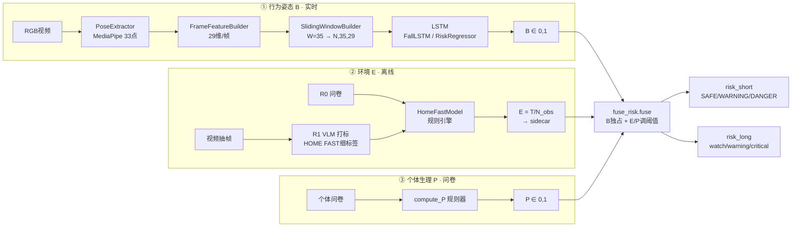

# 系统架构与设计文档 · 老年人跌倒风险预测系统（elder_decete）

> 本文档基于**当前代码实现**梳理系统架构、核心模块与端到端数据流，作为 `docs/架构.md`（模块实现笔记）的上层设计说明。两者互为补充：本文讲"整体怎么搭、数据怎么流"，`架构.md` 讲"每个模块怎么实现"。
>
> 配套可视化：`docs/系统架构图.svg`（总览架构图）。

---

## 1. 系统定位与目标

- **目标**：用**一路普通 RGB 摄像头视频**，实时估计老年人的**跌倒风险**，在跌倒发生前发出预警，并为长期高危人群筛查提供依据。
- **双输出**：
  - `risk_short`（短期报警）：秒级，判"现在会不会马上摔"，≥ θ_alarm 触发报警。
  - `risk_long`（长期监护分）：天/周级，判"这人整体是不是高危"，只分档不实时响。
- **范式（2026-07-13 评审确定）**：风险由 **B（行为姿态）× E（环境）× P（个体生理）** 三因子融合，但**只有 B 是实时态势分量**；E、P **只调节报警灵敏度（阈值偏置），不进入风险分数本身**——以此杜绝"阈值堆叠误报"和"个体差异被忽略"。

---

## 2. 总体架构



> 一张图看懂：唯一数据源是 RGB 视频；B 在线实时跑出连续风险，**E/P 离线/低频**只出标量去"调阈值"和"算长期分"。完整配色版架构图见 `docs/系统架构图.svg`。

---

## 3. 核心模块详解

### 3.1 数据接入与姿态提取 — `pose/`

| 文件 | 公开接口 | 职责 |
|------|----------|------|
| `keypoint.py` | `BodyPart`(33枚举)、`Keypoint`、`PoseResult`、`CORE_JOINTS_13` | 关键点数据结构 |
| `extractor.py` | `PoseExtractor.detect_frame / process_video / process_webcam` | 封装 MediaPipe Pose Landmarker (Tasks API)，GPU→CPU 回退 |
| `config_loader.py` | `load_pose_config(yaml)` | 读取 `config/pose_config.yaml` |

**输出 `PoseResult`**：
- `landmarks`：33 关键点，`x,y ∈ [0,1]` 归一化，`z` 相对深度，`visibility`；`.array → (33,4)`。
- `world_landmarks`：33 关键点 **3D 世界坐标（米）**，原点髋中心——用于步速、躯干角等物理量。
- 检测置信门控 `min_pose_presence_confidence=0.6`。

### 3.2 单帧 29 维特征 — `features/`（当前主干）

`features/feature_builder.py · FrameFeatureBuilder.build(result, gait_speed) → (29,) float32`：

| 索引 | 字段 | 来源 | 坐标 |
|------|------|------|------|
| 0 | `gait_speed` | `GaitSpeedExtractor.compute_per_frame`（12 帧足中心速度，m/s） | world |
| 1 | `trunk_angle` | `TorsoAngleExtractor`（三平面 arctan2 躯干倾角） | world→[-1,1] |
| 2 | `aspect_ratio` | `SkeletonFeatureExtractor`（bbox 宽高比） | 2D |
| 3–28 | `skeleton_26` | `PoseResult.landmarks[CORE_JOINTS_13]` ×(x,y) | 2D |

> ⚠️ **两套 `FrameFeatureBuilder` 并存**：`features/feature_builder.py`（主干，29 维，`build(result, gait_speed)`）与 `sequence/feature_vector.py`（旧版，config 驱动）。主干与 `build_from_cache.py` / `demo.py` 一律用 `features/` 这套。另有遗留 5 维 `features/pipeline.py`（未接入主干）。

**其余特征提取器**（被 FrameFeatureBuilder 复用或实验用）：`gait.py`、`torso.py`、`skeleton.py`、`joint_angle.py`（7 维角度，V4 实验用，默认关）。

### 3.3 时序窗口 — `sequence/`

`sequence/window.py · SlidingWindowBuilder`：
- `build(results, scalars)`：T 帧 → 滑窗 `(N, W, 29)`，stride=1 稠密。
- `build_from_array(features, labels, risk)`：训练用，窗口标签 = **窗口最后一帧**标签（`labels[start+W-1]`）。
- `velocity.py`：`add_velocity / add_acceleration`（V2/V3 实验，+26 维/次）。

> `WINDOW_SIZE` 默认 **35**（对齐 CAUCAFall `PRE_WINDOW=35` ≈1.4s 预冲击窗）；但 `demo.py` 默认 `window_size=25`、`v5_w25` 模型用 25——LSTM 取最后隐状态，**窗口尺寸与模型解耦**，任意 W 可跑。

### 3.4 行为姿态模型 B — `model/lstm/`

同一骨干、两种输出头（均 **2 层 LSTM(64) + Dropout(0.3)，batch_first，取最后帧 hidden**）：

| 模型 | 文件 | 输出头 | 标签 | 最佳产物 |
|------|------|--------|------|----------|
| `FallLSTM`（三分类） | `model.py` | `Linear(64,3)+softmax` | 窗口末帧 0/1/2 (Normal/Unstable/Fall) | `v1_pv/` U-F1=0.664（旧基线，冻结） |
| `RiskRegressor`（连续回归，主推） | `risk_model.py` | `Linear(64,1)+sigmoid` | 指数平滑 ramp 0.3→0.7→1.0 | `risk_v1/run_03/` R²=0.683，跌倒前触发率 99.6% |

- 训练/评估在 `scripts/`：`train_lstm.py`、`train_risk.py`、`eval_model.py`、`eval_risk.py`（不在 `model/lstm/`）。
- 风险目标曲线 `y(t)`：以 `u_start`(入不稳)、`f_start`(跌倒起点) 为锚点，pre-fall 指数 ramp 0.3→0.7，`RAMP_HI=0.7` 是**标签封顶、非报警线**（报警线统一 0.3/0.6）。`RISK_HORIZON=35` 可经 `regen_risk_labels.py --horizon` 覆盖。
- `RiskMultiTask`（双头）已实现但 `MULTITASK=False` 关闭。

### 3.5 环境风险 E — `model/env/` + `scripts/env_*.py`

**规则引擎（零训练零推理）**：`model/env/env_risk_model.py · HomeFastModel`
- `score(answers)`：25 题 HOME FAST（"否(隐患)"=1 分）→ `T(0~25)`；`E = T / N_obs`（N_obs 剔除 N/A 题）∈[0,1]；分级 `T≤4 低 / 5~7 中 / ≥8 高`。
- `from_labels(labels, room)`：R1 VLM 细标签（room/lighting/corridor_clear/toilet_grab_bar/pet_*…）→ 25 题 0/1 → 同一 `score()`。**看不清的字段 VLM 输出 `null` → 跳过当 N/A（不瞎猜）**。
- `save_env_sidecar`：写 `<stem>.env_risk.npy`(T,) + `<stem>.env_meta.json`（覆盖度守卫：`N_obs/25 < 0.6 → need_review`）。

**R0 / R1 两条来源，规则只有一份**：

| 阶段 | 脚本 | 链路 |
|------|------|------|
| R1 抽帧 | `env_extract_frames.py` | 视频 → `frames/<ds>/<stem>/f*.jpg` + `index.csv`（K=3 帧） |
| R1 打标 | `env_label_vlm.py` | `index.csv` → `env_labels/<ds>/<stem>.json`；调用方舟 ark (Doubao-Seed-1.6-vision)，`--mock` 离线验证，超时 60s |
| R1→sidecar | `env_labels_to_risk.py` | 标签 → risk / 写 sidecar |
| 编排(R1优先/R0回退) | `env_perceive.py` | 每 npz 取 R1 标签，无则 R0 元标签 → sidecar |

> **时延安全**：R1 是**离线管线**——VLM 只在批处理阶段打标，热路径只读 sidecar，绝不在报警回路在线调 VLM API（会击穿 0.19s DANGER 窗）。

### 3.6 个体生理 P — 规则器（无模型）

`fuse_risk.py · compute_P(questionnaire)`：年龄≥75(+10)/≥85(+10)、近12月跌倒史(+25)、助行器(+10)、独居(+10)、眩晕(+15)，封顶 `P_MAX=100` → `P = min(Σ,100)/100`。**仅进长期 `risk_long` 与调阈值，不进短期报警分数**。论文依据 Kucukaydin 2026 (ANN+BBS, R²=0.88)。

### 3.7 三因子融合 — `scripts/fuse_risk.py`

核心函数 `fuse(B, E, P, ...)` 实现阈值调节范式：

```
risk_short = B                                  # B 唯一态势分量，E/P 不进分数
ctx        = CTX_W_E·E + CTX_W_P·P              # = 0.60·E + 0.40·P
θ_alarm     = clamp(THR_ALARM_BASE − CTX_GAIN·ctx, THR_ALARM_FLOOR, THR_ALARM_BASE)
                                          # = clamp(0.60 − 0.20·ctx, 0.45, 0.60)
alarm      ⇔ B ≥ θ_alarm
risk_long  = clamp(FUSE_W_E_ST·E + FUSE_W_P·P, 0, 1)   # = 0.15·E + 0.40·P
```

- **硬下限**：`THR_ALARM_FLOOR=0.45` —— 任何上下文都救不回 `B<0.45` 的良性动作（弯腰/蹲下/捡物永不报警），物理封死误报。
- **可选 I-gate**（意图轨道 `features/env_mask.py` + `intent.py` + `intent_gate.py`，默认关闭）：`E_eff(t)=E·I(t)`，仅影响 θ 上下文，不影响分数。
- **输出顺序**（用户要求）：逐分量打印 B / E / (I) / P，再打印总风险（risk_short、θ_alarm、risk_long、等级、报警帧、触发因素）→ 汇总 `fuse_metrics.json`。

### 3.8 配置中心 — `scripts/build_config.py`（单一事实源）

所有阈值/权重集中于此，**不硬编码、CLI `--xxx` 可覆盖**：

| 分组 | 关键常量 | 值 |
|------|----------|----|
| 窗口 | `WINDOW_SIZE / STRIDE` | 35 / 1 |
| 风险标签 | `RISK_HORIZON / RAMP_LO / RAMP_HI / TAU_U / TAU_ABN` | 35 / 0.3 / 0.7 / 12 / 20 |
| 报警阈值 | `THR_ALARM_BASE / THR_ALARM_FLOOR / THR_WARN_BASE / THR_WARN_FLOOR` | 0.60 / 0.45 / 0.40 / 0.30 |
| 上下文 | `CTX_W_E / CTX_W_P / CTX_GAIN / CTX_MAX` | 0.60 / 0.40 / 0.20 / 1.00 |
| 融合 | `FUSE_W_B / FUSE_W_E_ST / FUSE_W_P` | 1.00 / 0.15 / 0.40 |
| 环境/VLM | `ENV_VLM_PROVIDER / ENV_VLM_MODEL / ENV_VLM_FRAMES_PER_VIDEO / ENV_VLM_TIMEOUT` | ark / Doubao-Seed-1.6-vision / 3 / 60 |
| HOME FAST | `HOME_FAST_COVERAGE_FLOOR / HOME_FAST_LEVEL_*` | 0.6 / 4 / 7 |
| 个体 P | `P_AGE_75 / P_FALL_HIST / P_DIZZY / P_MAX` | 10 / 25 / 15 / 100 |

---

## 4. 端到端数据流

### 4.1 训练流（离线、一次性 → 可复用缓存）

```
原始视频(5数据集, 不在仓库)
  └─ build_cache.py ──→ pose_cache/<ds>/<stem>.npz
        (MediaPipe 33点 + 逐帧 labels 0/1/2, 一次性, 免重跑)
  └─ regen_risk_labels.py ──→ <stem>.risk.npy  (labels→连续 risk, 指数 ramp)
  └─ build_from_cache.py ──→ datasets/experiment/<ver>/  (29维特征→滑窗→X/y)
  └─ train_lstm.py / train_risk.py ──→ best_model.pt + model_info.json
  └─ eval_model.py / eval_risk.py ──→ 指标 + 曲线图
```

### 4.2 推理流（实时 demo）

```
摄像头/视频帧
  → PoseExtractor.detect_frame → PoseResult
  → GaitSpeedExtractor.compute_per_frame → gait_speed
  → FrameFeatureBuilder.build(result, gait_speed) → (29,)
  → deque(maxlen=W) 在线滑窗 → (1, W, 29)
  → RiskRegressor(x).item() → B ∈ [0,1]   （或 FallLSTM 3类 → 0.1·P(N)+0.6·P(U)+0.9·P(F)）
  → fuse_risk(B, E_sidecar, P_问卷)
       E：离线 R1 预存 sidecar（env_perceive 生成）
       P：问卷规则 compute_P
  → risk_short（分级 + 报警帧）/ risk_long（分档）
```

### 4.3 环境 E 离线流（R1）

```
视频 → env_extract_frames(K=3) → frames/index.csv
     → env_label_vlm(VLM) → env_labels/<ds>/<stem>.json
     → env_perceive(R1优先/R0回退) → <stem>.env_risk.npy + env_meta.json (sidecar)
     → 推理时热路径只读 sidecar，零 API 时延
```

---

## 5. 数据存储布局

| 路径 | 内容 | 是否入库 |
|------|------|----------|
| `pose_cache/<ds>/<stem>.npz` | landmarks/world_landmarks/visibility/timestamps/labels/video_id（T 帧） | 否（已忽略） |
| `pose_cache/<ds>/<stem>.risk.npy` | 连续行为风险 (T,) | 否 |
| `pose_cache/<ds>/<stem>.env_risk.npy` + `.env_meta.json` | 环境分 sidecar | 否 |
| `datasets/experiment/<ver>/` | `X_*.npy / y_risk_*.npy / y_cls_*.npy / split_log.json` | 否 |
| `frames/<ds>/<stem>/f*.jpg` + `index.csv` | R1 抽帧 | 否 |
| `env_labels/<ds>/<stem>.json` + `_raw/` | R1 聚合/逐帧标签 | 否 |
| `env_baselines/<scene>.json` | 静态环境基线（地面/障碍 bbox，bg_diff 模式用） | 否 |
| `model/lstm/risk_v1/run_03/`、`v5_w35/run_01/` | ★ 两个最优模型（强制入库） | **是** |
| `config/`、`docs/`、`demo/`、`scripts/`、`pose/`、`features/`、`model/lstm/*.py` | 代码与文档 | 是 |
| `.env`、`.task`、绝大多数 `.pt` | 密钥/大模型/实验权重 | 否 |

---

## 6. 双输出语义与产品定位

| 输出 | 喂入 | 时间窗 | 触发/分档 | 真实价值 |
|------|------|--------|-----------|----------|
| **risk_short** | B（唯一分量，已含 gait） | 秒级 (W≈1.4s) | ≥θ_alarm → DANGER | **撞击瞬间零延时呼救** + **同室事中声光喝止** |
| **risk_long** | E(HOME FAST) + P(问卷) | 天/周级 | watch/warning/critical | **fall prevention 结构性干预抓手**（扶手/照明/PT） |

> **产品公理**：护工 1.5s 内冲不进房间是铁律。`RAMP_HI=0.7 / H=35≈1.4s` 是**训练标签定义**而非对用户承诺；模型实际能报 WARNING=0.99s / DANGER=0.19s。`risk_short` 不等于"接住老人"，**预防的真正抓手是 `risk_long`**。

---

## 7. 关键设计决策

1. **B 独占态势 + E/P 调阈值**：环境/个体绝不进 `risk_short` 分数（否则场景能把良性动作推过线 → 养老院高频误报拔电源）；二者只下调阈值（有硬下限 0.45）。
2. **HOME FAST 取代旧 room/light/floor 三查表**（2026-07-13）：25 题单一归一化分 `E=T/N_obs`，同时喂长期与阈值上下文；覆盖度守卫防单视频不全屋误判。
3. **VLM 离线、热路径零 API**：R1 只在批处理打标，sidecar 预存，报警回路不在线调模型。
4. **配置单一事实源**：所有超参进 `build_config.py`，CLI 可临时覆盖，杜绝散落硬编码。
5. **窗口尺寸与模型解耦**：LSTM 取最后隐状态，W 任意；RISK_HORIZON 改需重打标+重训。

---

## 8. 当前实现状态与已知问题（接手必读）

### ✅ 已完成（可跑、可复现）
- B 因子：RiskRegressor（连续）+ FallLSTM（三分类），两个最优模型已入库。
- E 因子：HomeFastModel R0/R1 共用规则，覆盖度守卫，VLM 不瞎猜。
- 三因子融合：阈值调节范式 + 硬下限；实时 demo、环境 demo、单元测试 17 项。

### ⚠️ 需注意的代码—文档偏差 / 已知问题（已核对代码）
1. **提交的 R1 环境标签是旧格式 → E 路径当前 inert**：代码按 `"corridor_clear" in agg` 判定新 HOME FAST 格式，否则 `E=0`。但 `env_labels/` 现有标签是旧 `floor_hazard/fall_risk` schema，**不含 `corridor_clear`**，因此现有 R1 标签对融合无贡献。需重跑 `env_label_vlm.py`（现已发 HOME FAST prompt）让标签含 `corridor_clear` 等字段才能激活。
2. **sidecar 陈旧**：磁盘上 `pose_cache/*.env_meta.json` 由旧版 `env_perceive.py` 生成（旧键 `light_level/floor_hazard/risk_env:0.3`），与当前 `save_env_sidecar`（写 `lighting/homefast_total/need_review` 等）不一致——需重跑 `env_perceive.py` 重建。
3. **`W=35` vs `W=25`**：规范默认 35，但 `demo.py` 默认 25、`v5_w25` 用 25；二者均可跑（模型窗口无关）。
4. **两套特征/FrameFeatureBuilder 并存**：主干 `features/feature_builder.py`（29 维）与旧 `sequence/feature_vector.py`；勿混用。
5. **"B" 命名冲突**：融合里的 B=行为姿态；`features/env_mask.py`/`intent.py` 的"轨道B/C"是**另一套环境交互意图设计**（I-gate），与三因子 B 无关，文档/图中已区分。
6. **训练/评估脚本在 `scripts/` 而非 `model/lstm/`**（`model/lstm/` 仅 `model.py`/`risk_model.py` + 各 run 权重）。

### 🚧 待办
- CAUCAFall 等带 pose npz 数据集接入 `env_perceive` 挂 sidecar，真正闭合 E 因子。
- Run04 中段加权攻坚三相机数据集偏置（代码就绪待跑）。
- P 因子扩展（BBS/TUG/多重用药等，见 `跌倒风险预测_汇报.md` 附录 A.3）。
- 端侧轻量地面 hazard 检测器替代 VLM API，实现真·实时 E。

---

## 9. 模块索引（文件 → 职责）

| 文件 | 职责 |
|------|------|
| `config/pose_config.yaml` | MediaPipe 姿态提取配置（model_version/selected_joints/use_gpu） |
| `pose/{keypoint,extractor,config_loader}.py` | 姿态提取封装与数据结构 |
| `features/feature_builder.py` | ★ 单帧 29 维特征（主干） |
| `features/{gait,torso,skeleton,joint_angle}.py` | 标量特征提取器（被主干复用/实验用） |
| `features/{env_mask,intent,intent_gate}.py` | 环境交互意图轨道（I-gate，默认关） |
| `sequence/{config,window,velocity,feature_vector}.py` | 滑窗/速度加速度特征 |
| `model/lstm/model.py` | `FallLSTM`（三分类） |
| `model/lstm/risk_model.py` | `RiskRegressor` / `RiskMultiTask`（连续回归，主推） |
| `model/env/env_risk_model.py` | `HomeFastModel`（E 规则引擎，零训练） |
| `scripts/build_cache.py` | 阶段1：视频 → pose_cache/*.npz |
| `scripts/regen_risk_labels.py` | 阶段1.5：labels → 连续 risk |
| `scripts/build_from_cache.py` | 阶段2：缓存 → 29维 → 滑窗 → datasets |
| `scripts/train_lstm.py` / `train_risk.py` | 训练 FallLSTM / RiskRegressor |
| `scripts/eval_model.py` / `eval_risk.py` | 评估分类 / 回归 |
| `scripts/env_extract_frames.py` / `env_label_vlm.py` / `env_labels_to_risk.py` | R1 抽帧/打标/转 risk |
| `scripts/env_perceive.py` | R1 优先/R0 回退，写 sidecar |
| `scripts/fuse_risk.py` | ★ 三因子融合（阈值调节）+ 双输出 |
| `scripts/build_config.py` | ★ 全部超参单一事实源 |
| `demo/demo.py` | 实时跌倒风险预测（摄像头/视频） |
| `demo/demo_env_risk.py` | 环境风险 HOME FAST 评分卡独立 demo |

---

## 10. 相关文档

- `docs/架构.md` — 模块级实现笔记（坐标、标签、构建脚本三条路径、论文对齐）。
- `docs/跌倒风险预测_汇报.md` — 总览 + 设计 + 算例 + 论文索引 + 复现命令。
- `docs/系统架构图.svg` — 本文配套架构图。
- 量表：`docs/HOME FAST 居家跌倒筛查量表.md`、`docs/morse.md`、`docs/Tinetti平衡与步态量表.md`、`docs/7.md`。
- 环境交互意图设计（独立轨道）：`docs/环境交互风险预测_设计.md`、`docs/RTMPose_STGCN_*.md`。
