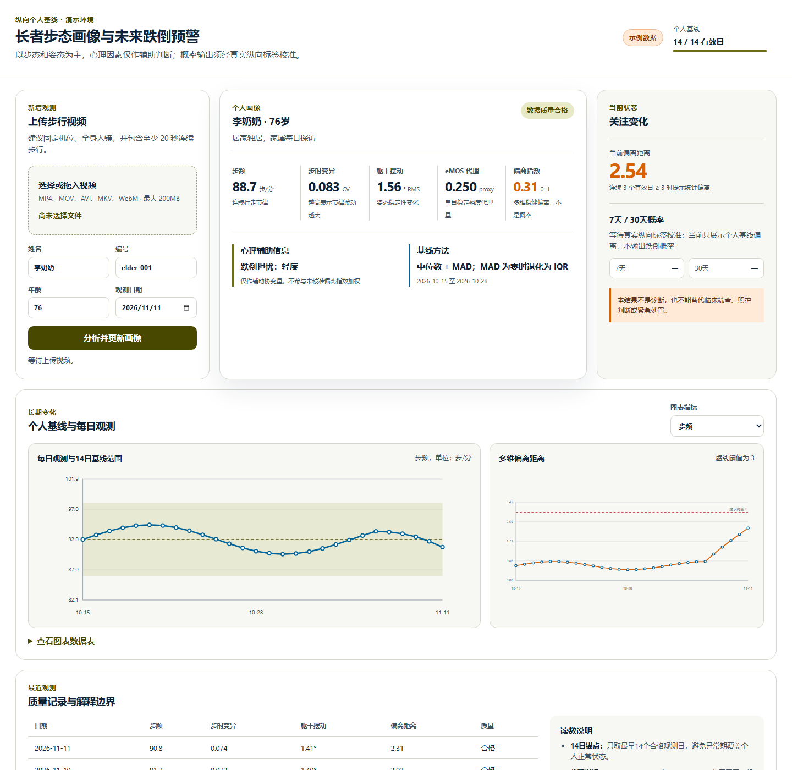

# 老年人纵向跌倒预警功能说明

**版本：** Demo 1.0  
**日期：** 2026-11-11  
**定位：** 在现有实时跌倒检测系统之外，增加以个人步态、姿态为主的天/周级纵向画像、基线偏离监测和未来时间窗预警能力。

> 重要说明：本功能用于统计变化监测、人工复核和研究演示，不是医疗器械结论，不替代临床筛查、照护判断或紧急处置。仓库当前不含真实纵向跌倒随访标签，因此默认不输出未来跌倒概率。

## 摘要

新增功能围绕“同一个老人是否逐渐偏离自己的正常状态”建模。系统持续接收步行视频或每日姿态摘要，在数据质量合格的前提下，以最早 14 个有效观测日建立固定个人锚点；随后使用中位数、MAD 和 IQR 等稳健统计量，计算每日多维偏离距离、变化趋势和持续时间。若取得真实纵向随访标签并完成独立验证，可再通过 Landmark Cox 生存模型把偏离特征映射为未来 7 天和 30 天累计跌倒概率。

步态和姿态是画像主体。心理因素只作为可选训练协变量，用于补充解释，不通过人工权重改变未校准偏离指数。`gait_speed_proxy` 和 `emos_proxy` 均为单目视觉代理量，只适合同一人在稳定机位下进行纵向比较。

## 1. 与现有系统的关系

现有项目已经具备视频级和帧级的实时跌倒风险处理链路。本次新增功能与原链路解耦，只增加纵向画像、个人基线和未来窗口预警，不修改 ST-GCN、LSTM、环境风险、意图门控或原报警阈值。

| 能力层 | 现有功能 | 本次新增功能 | 关系 |
|---|---|---|---|
| 姿态输入 | MediaPipe 3D、YOLO-Pose 2D | 复用姿态序列，进一步形成每日步态/姿态摘要 | 复用，不替换 |
| 实时风险 | ST-GCN 或 LSTM 输出行为风险 B | 不修改 | 完全保留 |
| 告警状态 | SAFE / WARNING / DANGER | 增加 collecting、baseline_ready、calibration_required、calibrated 等纵向状态 | 并行存在 |
| 实时稳态处理 | EMA 平滑、迟滞去抖、连续帧确认 | 采用日级质量门控和持续偏离确认 | 时间尺度不同 |
| 风险融合 | 环境风险 E、个体风险 P、运动意图门控 I | 可通过 `future_risk` 字段附加纵向结果 | 显式可选接入 |
| 输出 | 标注视频、逐帧 CSV、风险曲线、运行统计 JSON | observations.jsonl、baseline.json、latest_risk.json、Web 画像 | 互不覆盖 |

原有链路回答“当前画面是否出现即时危险行为”；新增链路回答“近期步态、姿态是否持续偏离本人基线，以及在经过真实标签校准后，未来 7 天或 30 天的累计跌倒风险是多少”。两类结果不能互相替代。

## 2. 功能流程

完整流程如下：

1. 接收步行视频、姿态 NPZ 或每日特征 JSON。
2. 提取步态、姿态特征和质量指标。
3. 执行质量门控；不合格观测不进入基线和风险计算。
4. 收集最早 14 个有效观测日，建立固定个人锚点。
5. 对后续每个有效日计算特征 z 分数、多维偏离距离和 `deviation_index`。
6. 使用低偏离有效观测维护慢速参考线，用于观察长期漂移；固定 14 日锚点不被自动覆盖。
7. 连续 3 个有效观测日偏离距离达到阈值时，产生统计偏离提示并要求人工复核。
8. 只有在具有真实纵向标签、独立验证结果和严格校准模型时，才输出未来 7 天、30 天累计跌倒概率。

Web Demo 提供两种明确区分的工作状态：

- **示例模式：** 页面展示 28 日示例画像，所有内容标注为示例数据。上传视频但缺少 MediaPipe `.task` 模型时，返回 `sample_fallback`，不会把示例指标冒充为视频分析结果。
- **真实单次观测模式：** 姿态模型可用时，上传视频生成真实姿态摘要。此时仅显示 `1/14` 基线采集中，偏离指数、偏离距离和未来概率均为空，不继承示例结论。

## 3. 老年人画像模型

### 3.1 步态主体特征

| 字段 | 含义 | 解释边界 |
|---|---|---|
| `gait_speed_proxy` | 髋部移动速度经人体尺度归一化后的代理量 | 不是米/秒，只能同人、同机位纵向比较 |
| `cadence_spm` | 每分钟步数 | 描述行走节律 |
| `step_time_mean_s` | 平均步时 | 描述相邻步事件的时间间隔 |
| `step_time_cv` | 步时变异系数 | 描述节律波动，不单独等于跌倒风险 |
| `stance_width_norm` | 双踝间距相对人体尺度的归一化值 | 受视角和遮挡影响 |
| `gait_asymmetry` | 左右步态周期差异 | 单侧事件不足时不填充为理想值 0 |

步事件使用相对髋部、按人体尺度归一化的踝轨迹，避免把身体整体上下移动或相机轻微抖动误识别为步伐。

### 3.2 姿态主体特征

| 字段 | 含义 | 解释边界 |
|---|---|---|
| `trunk_tilt_mean_deg` | 躯干平均倾斜角 | 描述姿态中心，不代表诊断 |
| `trunk_sway_rms_deg` | 躯干摆动均方根 | 描述姿态波动 |
| `aspect_ratio_mean` / `aspect_ratio_cv` | 人体包围框宽高比及其变异 | 对机位和画面裁剪敏感 |
| `emos_proxy` | 质心代理相对双踝支撑范围的稳定裕度代理 | 不是经过测力台验证的真实 eMOS |

### 3.3 心理辅助信息

跌倒担忧、FES-I 等心理信息可以作为 Landmark Cox 训练时的可选协变量，帮助解释风险差异。未校准阶段不设置人工心理权重，不用心理分数直接提高或降低 `deviation_index`，避免主观赋权掩盖真实步态、姿态变化。

## 4. 数据质量门控

默认质量门控如下：

| 指标 | 默认下限 | 作用 |
|---|---:|---|
| 有效帧数 | 150 帧 | 保证姿态统计量有基本样本量 |
| 有效步数 | 20 步 | 保证步时和节律统计可计算 |
| 有效步行时长 | 20 秒 | 避免极短片段主导结果 |
| 平均置信度 | 0.5 | 排除低可信关键点序列 |
| 核心特征覆盖率 | 80% | 防止大量缺失特征进入基线 |

这些数值是工程质量门控，不是临床诊断阈值。质量字段必须为有限、非负的合法数值；置信度限制在 `[0,1]`。NPZ 输入必须同时包含：

- `landmarks`：形状为 `(T, J, 2|3)` 的关键点数组；
- `timestamps`：单调递增的时间戳；
- `visibility`：与关键点对应的可见度/置信度。

系统不再把缺失时间戳默认为固定帧率，也不把缺失可见度填成全 1，以免缺乏质量证据的数据被误判为“完美质量”。

## 5. 个人基线与偏离算法

### 5.1 固定 14 日锚点

基线只使用最早 14 个质量合格的自然日。设第 `j` 个特征在基线期的样本为 `x_1j ... x_14j`：

- 中心：`B_j = median(x_1j ... x_14j)`
- 首选尺度：`sigma_j = 1.4826 × MAD_j`
- 当 MAD 为 0 时：`sigma_j = IQR_j / 1.349`
- 若仍为 0，则该特征为常量特征，停止参与多维偏离距离，避免除零和伪异常。

14 日固定锚点用于回答“相对初始稳定状态偏离了多少”。它不会被新增观测自动重建，保证历史结果可解释、可审计。

### 5.2 单日偏离与多维距离

后续观测的稳健 z 分数为：

`z_j(t) = clip((x_j(t) - B_j) / sigma_j, -6, 6)`

多维偏离距离为：

`distance(t) = sqrt(mean(z_j(t)^2))`

界面偏离指数为：

`deviation_index(t) = min(distance(t) / 6, 1)`

`deviation_index` 只表示当前多维特征离本人基线有多远，取值范围为 `[0,1]`，不是跌倒概率。

### 5.3 持续偏离与慢速参考线

当尾部连续 3 个质量合格观测日满足 `distance >= 3` 时，系统提示持续统计偏离。阈值 3 与稳健标准化的工程异常检测思路一致；连续 3 日规则是为减少单日姿态误差、遮挡或偶然波动所采用的保守抗噪策略，不是临床阈值，也不等于未来会跌倒。

慢速参考线只吸收低偏离、质量合格的新增观测，用于观察长期自然变化和摄像机漂移。固定锚点负责可比性，慢速参考线负责背景变化识别，二者职责不同。

## 6. Landmark Cox 生存模型

当取得带跌倒日期或删失日期的真实纵向随访数据后，每个有效观测日可作为 Landmark 预测时点，使用偏离距离、7 日趋势、持续偏离天数和可选心理协变量拟合 Cox 比例风险模型。

项目采用的累计风险公式为：

`risk(h) = 1 - S0(h) ^ exp(beta^T (x - center))`

其中，`h` 为 7 天或 30 天窗口，`S0(h)` 为基线生存率，`beta` 为 Cox 系数，`center` 为训练特征中心。特征中心化必须与 lifelines 的训练定义保持一致。

模型安全契约包括：

- 模型产物使用严格 `schema_version = 2`；
- 7 天和 30 天模型必须具有相同 `bundle_id`、特征顺序、校准状态和证据标识；
- 基线生存率按阶梯函数取值，不做线性插值；
- 校准标志必须是真正的 JSON boolean，字符串 `"false"` 不被接受；
- 只有提供真实独立验证指标并显式标记 `calibrated=true` 后，才能输出概率；
- 未校准或缺少成对模型时，`risk_7d` 和 `risk_30d` 必须为 `null`。

## 7. 预测时间窗及权威依据

| 研究/权威方法 | 文献结论与适用点 | 本项目工程落地 |
|---|---|---|
| Mehdizadeh 等，2021 | 在高风险痴呆人群的自然环境步态监测中使用两周观测，并采用 Cox 方法评估短期 7 天和 30 天风险 | 采用 14 个有效日建立个人初始基线；固定 7 天和 30 天输出窗口 |
| Adeli 等，2023 | 使用环境视觉步态与机器学习进行动态、短期跌倒风险评估，预测尺度约为未来 4 周 | 支持日级更新，并为约 30 天窗口提供独立方向性依据 |
| Cox，1972 | 提出比例风险回归模型 | 有真实标签后建立条件累计风险映射 |
| van Houwelingen，2007 | 系统化 Landmark 动态预测 | 把每个有效观测日作为新的预测时点 |
| Iglewicz 与 Hoaglin，1993；NIST/SEMATECH | 稳健离群值、MAD 与统计过程监测方法 | 中位数/MAD、IQR 回退、稳健偏离与人工复核 |

因此，本项目只实现未来 7 天和 30 天两个累计风险窗口。24 小时和 72 小时窗口未纳入当前输出，因为现有采集条件下没有对应的直接论文依据和事件标签，不能用示例百分比代替真实校准。

## 8. Web Demo 使用

### 8.1 启动

在项目根目录执行：

```powershell
D:\tools\anaconda\python.exe scripts\run_web_demo.py
```

浏览器访问：`http://127.0.0.1:5000`

### 8.2 页面区域

1. 上传区：选择或拖入 MP4、MOV、AVI、MKV、WebM 视频，填写姓名、编号、年龄和观测日期。
2. 画像区：显示步频、步时变异、躯干摆动、eMOS 代理量和偏离指数。
3. 状态区：显示当前偏离距离、基线阶段和概率校准状态。
4. 趋势区：示例模式展示每日观测、14 日基线范围及偏离距离；真实基线不足 14 日时显示采集空状态，不绘制伪基线。
5. 历史和质量区：展示最近观测、有效帧、步数、时长、置信度和模型边界。



*图 1 纵向个人基线跌倒预警 Web Demo。截图为明确标记的示例数据，不能作为上传视频的真实分析结论。*

### 8.3 真实姿态模型

默认姿态模型路径为：

`model/mediapipe_pose/pose_landmarker_lite.task`

若模型或相关依赖缺失，上传后页面会明确显示示例回退警告。模型可用时，后端使用现有 `PoseExtractor.detect_frame()` 读取真实关键点，再调用 `summarize_pose_sequence()` 生成姿态摘要。为防止无人或遮挡视频长期占用服务，最多读取 3000 个原始帧；上传临时文件在请求完成后删除。

> Flask 自带开发服务器只用于本地演示。生产部署应使用受控 WSGI 服务、身份认证、访问审计、文件扫描和加密存储。

## 9. CLI 与数据文件

### 9.1 导入每日观测

```powershell
python scripts\collect_longitudinal.py `
  --input daily.json `
  --person-id elder_001 `
  --observed-at 2026-11-01 `
  --profile-dir profiles
```

输入可为每日特征 JSON，或同时含 `landmarks/timestamps/visibility` 的 NPZ。

### 9.2 建立个人基线

```powershell
python scripts\build_personal_baseline.py `
  --person-id elder_001 `
  --profile-dir profiles
```

### 9.3 计算最新偏离或概率

```powershell
python scripts\predict_future_fall.py `
  --person-id elder_001 `
  --profile-dir profiles
```

加载经过独立验证的成对模型时，可增加 `--model-7d` 和 `--model-30d`。

### 9.4 训练 Landmark Cox

```powershell
python scripts\train_landmark_cox.py `
  --data longitudinal_training.csv `
  --features distance trend_7d persistent_deviation_days `
  --out-dir model\longitudinal\cox_v1
```

默认产物为未校准状态。必须提供真实独立验证指标并显式使用校准参数，才能生成可输出概率的 bundle。

### 9.5 数据文件

```text
profiles/<person_id>/observations.jsonl
profiles/<person_id>/baseline.json
profiles/<person_id>/latest_risk.json
```

如需把纵向结果附加到原有汇总 JSON，可显式调用：

```powershell
python scripts\fuse_risk.py `
  --b-risk 0.1 `
  --future-risk-json profiles\elder_001\latest_risk.json
```

未传入 `--future-risk-json` 时，原有融合输出结构不变。

## 10. 主要创新点

1. **个体内建模。** 不用单一群体阈值评判所有老人，而是比较同一人当前状态与其自身稳定期。
2. **两层风险映射。** 第一层用稳健统计产生可解释的偏离量；第二层只在有真实标签时用 Landmark Cox 转换为时间窗概率。
3. **双时间尺度基线。** 固定 14 日锚点保证可追溯性，低偏离慢速参考线识别自然演变和设备漂移。
4. **概率校准闸门。** schema 2、`bundle_id`、特征中心、独立验证证据和严格 JSON 类型共同防止伪概率输出。
5. **心理因素辅助化。** 心理信息可以补充训练解释，但不通过人工权重覆盖步态、姿态主证据。
6. **与实时链路解耦。** 原有 B/E/P/I、ST-GCN、LSTM 和报警状态机不受影响；纵向结果作为可选附加信息落地。

## 11. 边界与部署建议

- 单目视觉无法直接恢复精确物理尺度，`gait_speed_proxy`、`emos_proxy` 必须保留 `proxy` 后缀。
- 建议同一人使用固定机位、相近焦距、相近行走路径和光照条件；更换摄像机或姿态后端后应重新建立基线。
- 遮挡、宽松衣物、助行器、画面裁剪和多人入镜可能降低关键点质量。
- 示例历史只能用于说明页面和流程，不能用于个人判断、模型训练或临床报告。
- 真实偏离判断至少需要 14 个质量合格的独立自然日；不足时应保持 `collecting`。
- 未来概率需要真实跌倒日期/删失日期、独立验证和人群适用性评估；模型能拟合不等于已经校准。
- 持续偏离提示必须结合照护记录、药物变化、急性疾病、活动量和临床评估进行人工复核。
- 视频和健康相关画像属于敏感数据，生产环境需实施最小化采集、访问控制、传输/静态加密、保存期限和删除机制。
- 缺少 MediaPipe `.task` 模型时，系统只进行示例回退；不得把示例数据写入真实个人档案。
- Flask 开发服务器不能直接暴露到公网；生产部署需增加反向代理、并发队列、上传限流、恶意文件扫描和监控。

## 12. 验证情况

在本轮实现中，已对以下行为建立自动化测试和回归检查：

- 数据契约、时区规范化、非有限数拒绝和中文质量原因；
- 最早 14 日固定基线、中位数/MAD、IQR 回退、z 截断、RMS 距离和持续偏离；
- 相对髋部踝轨迹，防止整体上下移动被误判为步伐；
- Cox 特征中心化、严格布尔校准标志、成对 bundle 和阶梯基线生存率；
- JSONL 个人身份隔离和融合概率的严格 JSON number 类型；
- NPZ 三个必需字段与毫秒时间戳转换；
- Web 首页、画像 API、上传格式、日期校验、空文件拒绝、临时文件清理；
- 示例回退与真实单次观测的数据来源隔离；
- 无人体视频也受 3000 原始帧硬上限约束；
- JavaScript 语法、Python 编译和 Flask 启动烟雾检查。

最近一次实现阶段回归记录为 58 项自动测试通过。最终交付前仍应在目标部署环境重新运行完整测试；旧项目 `smoke_test_body26.py` 若因缺少 MMPose 等旧依赖失败，应单独记录为原有环境依赖问题，不能据此放宽新增纵向功能的安全契约。

## 13. 参考文献

1. Mehdizadeh S, et al. *Predicting Short-Term Risk of Falls in a High-Risk Group With Dementia.* Journal of the American Medical Directors Association. DOI: `10.1016/j.jamda.2020.07.030`.
2. Adeli V, et al. *Ambient Monitoring of Gait and Machine Learning Models for Dynamic and Short-Term Falls Risk Assessment in People With Dementia.* IEEE Journal of Biomedical and Health Informatics. DOI: `10.1109/JBHI.2023.3267039`.
3. Cox DR. *Regression Models and Life-Tables.* Journal of the Royal Statistical Society: Series B. DOI: `10.1111/j.2517-6161.1972.tb00899.x`.
4. van Houwelingen HC. *Dynamic Prediction by Landmarking in Event History Analysis.* Scandinavian Journal of Statistics. DOI: `10.1111/j.1467-9469.2007.00529.x`.
5. Iglewicz B, Hoaglin DC. *How to Detect and Handle Outliers.* ASQC Quality Press, 1993.
6. NIST/SEMATECH. *e-Handbook of Statistical Methods.* Robust statistics and statistical process control sections.

---

**结论：** 当前 Demo 已完成从视频上传、姿态摘要接口、老人画像、14 日基线变化图到严格概率校准闸门的功能闭环。没有真实长期数据时，系统只输出可解释的偏离信息；取得真实随访标签并完成独立验证后，才启用 7 天和 30 天概率预测。
