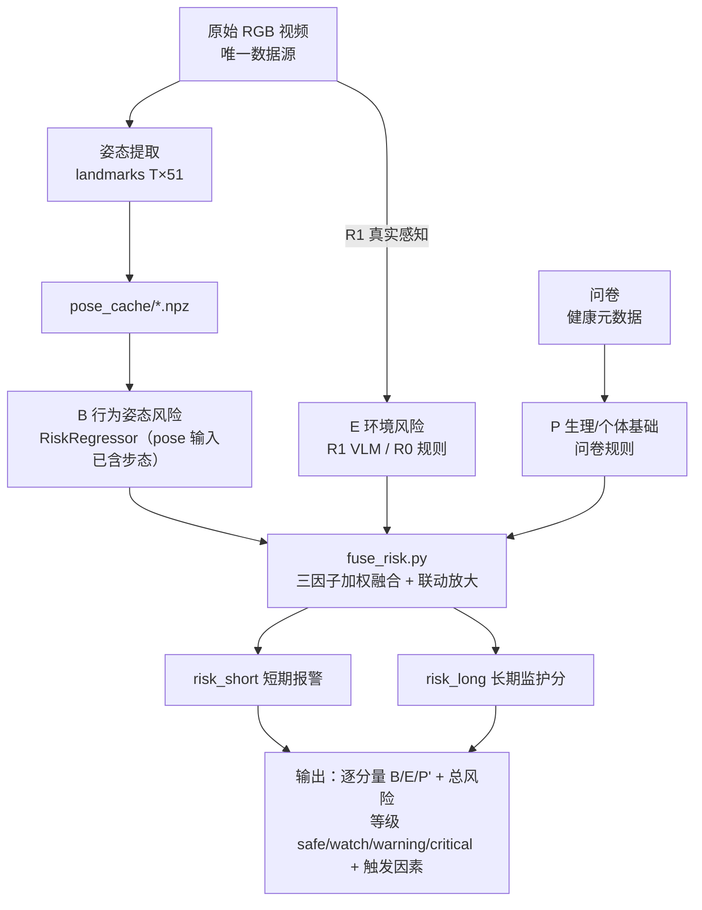
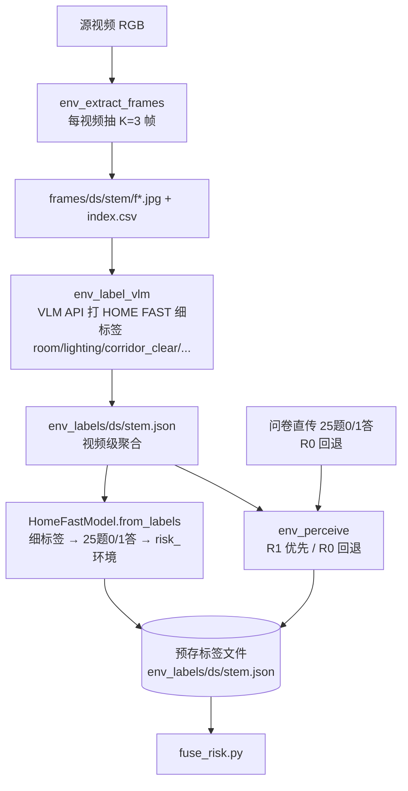

# 跌倒风险预测系统 · 设计汇报

> **一句话总览**：用一路普通摄像头视频，实时估算老年人的「短期跌倒报警风险」与「长期跌倒监护分」。通过**行为姿态(B) ＋ 环境(E) ＋ 生理/个体基础(P)** 三个因子加权融合实现（步态速度 / 摆动本就隐含在 B 的 pose 输入里，无需单独因子）；关键报警阈值统一为 0.3（预警）/ 0.6（报警）。

## 0. 背景与动机

- **问题**：跌倒是老年人致残、致死的首要原因；但多数跌倒**发生前已有步态 / 平衡异常**，存在预警窗口。
- **现有方案的不足**：多为**事后检测**（人已倒地才报警），或**单模态**（只看姿态、或依赖可穿戴设备），遗漏了「环境是否危险」与「这人本身是否高危」。
- **我们的思路**：**一路普通摄像头 + 多源风险融合**——在跌倒发生前数秒预警（短期报警），并给出长期高危人群筛查分（长期监护）。
- **三因子框架**：对应《跌倒前预测可行性报告》：**行为姿态(B) ＋ 环境(E) ＋ 生理 / 个体基础(P)**。

## 执行摘要（关键结果）

- **双输出**：`risk_short`（秒级报警，≥0.6 触发）＋ `risk_long`（天 / 周级监护分，分档）。
- **报警阈值统一 0.3（预警）/ 0.6（报警）**，与三分类基线一致。
- **行为姿态 B**：风险回归模型 `RiskRegressor` 连续输出，R²=0.683、相邻帧波动仅 0.0084（极稳）；WARNING 提前 0.99s、DANGER 提前 0.19s，跌倒前触发率 99.64%。
- **环境 E**：多模态大模型(VLM) 看画面打标（房间 / 光照 / 脚下），规则换算风险；设计依据 Bravo 2021（cFRs, AUC=0.790）。
- **生理基础 P**：问卷规则；设计依据 Kucukaydin 2026（ANN+BBS, R²=0.88）。
- 全部新模块**不改动**原有三分类管线，可独立删减、互不污染。

---

## 1. 整体设计：短期跌倒风险 ＋ 长期跌倒风险

### 1.1 双输出概念

同一路摄像头视频，抽出两类信号后分别服务两种时间尺度：

| 输出 | 喂入分量 | 时间窗 | 用途 | 触发 |
|------|----------|--------|------|------|
| **risk_short（短期报警）** | 行为姿态 B（即时，**唯一分量**，已含 gait） | 秒级（W=35≈1.4s） | 跌倒 imminent 报警 | ≥ θ_alarm（阈值随环境/个体下调） |
| **risk_long（长期监护分）** | 环境(HOME FAST 单一 E) ＋ 生理/个体基础（问卷） | 天 / 周级 | 高跌倒风险人群筛查 | 分档 |

- 行为姿态 的短期即时分量即 Phase-1 的 `RiskRegressor` 连续风险回归，**是 `risk_short` 的唯一态势分量**。
- 环境（HOME FAST 单一 E = T/N_obs）同时作 `risk_short` 的**阈值上下文**、喂长期 `risk_long`。
- 生理/个体基础 仅进长期（调阈值）；环境/个体都**只调 `risk_short` 的报警阈值，不进其分数**。

> **产品定位公理（回应评审 #4）**：`risk_short` 的真实价值**不是"接住老人"**——护工 1.5s 内冲不进房间，这是铁律。`RAMP_HI=0.7 / H=35≈1.4s` 是**训练标签定义**，不是对用户的承诺；模型实际能报的是 **WARNING=0.99s / DANGER=0.19s** 窗。`risk_short` 真正 deliver 的是：① **撞击瞬间零延时呼救**（事后急救——老人倒地无人发现数小时是致死主因）；② **同室事中声光喝止**（极少数打断跌倒反射/唤来同屋人）。而 fall **prevention（预防）的真正抓手是 `risk_long`**——筛高危人群+高危环境，做**结构性干预**（扶手/照明/PT）。执行器假设需写清：**墙摄 = 检测+升级；可穿戴气囊 = 可预防**（几十 ms 引爆，那 0.19s DANGER 窗才有意义）。

### 1.2 复合公式（三因子 → 双输出：B 独占 + E/P 调阈值）

我们一共有 3 个风险小分：**B** 行为姿态、**E** 环境、**P** 生理/个体基础（步态速度 / 摆动本就隐含在 B 的 pose 输入里，无需单独因子）。最终风险 = 这 3 个分**按重要性加权相加**（权重大的说得算）。

**为什么是两个公式（不是算错）**：同一路视频其实干两件事 ——
- **risk_short（短期报警）**：判「现在会不会马上摔」，只看当下正在发生的事，≥ 0.6 立刻报警。
- **risk_long（长期监护分）**：判「这人整体是不是高危」，看趋势和底子，只分档（watch/critical）不实时响。

```
risk_short = B                                    # B 唯一「此刻正在摔」信号（已含 gait），不混 E/P
risk_long  = w_E·E(HOME FAST) + w_P·P'          # 监护分，分档（E=HOME FAST 单分，P'=P 问卷个体基础）
# 上下文灵敏度：E 与 P 不进 risk_short 分数，只调报警/预警阈值
θ_alarm = clamp( θ_base − GAIN·ctx , θ_floor , θ_base )   # ctx = w_E·E(HOME FAST) + w_P·P
θ_warn  = clamp( θ_warn_base − GAIN·ctx , θ_warn_floor , θ_warn_base )
alarm  ⇔ B ≥ θ_alarm        # 阈值随危险上下文下调 → 越危险越敏感，但有硬下限
```

> 环境 **E 是 HOME FAST 单一归一化分**（E = T/N_obs，T 为 25 题隐患总分、N_obs 为实际观察题数），同时喂长期 `risk_long` 并作短期报警阈值上下文。**P（问卷）只进长期**，不进短期报警（不会因为「去年摔过」就现在响警报）。

**符号含义：**

| 符号 | 含义 |
|------|------|
| `risk_short` | 短期跌倒报警风险（秒级，≥ θ_alarm 触发） |
| `risk_long` | 长期跌倒监护分（天 / 周级，分档） |
| `B` | 行为姿态风险（RiskRegressor 输出，∈[0,1]，已含 gait） |
| `E` (HOME FAST) | 环境风险单一归一化分 = T/N_obs ∈[0,1]，长期分量（`risk_long`）+ 短期报警/预警阈值上下文（不进 `risk_short` 分数） |
| `P` / `P'` | 生理 / 个体基础风险（问卷规则，∈[0,1]） |
| `w_*` | 各分量融合权重，取值见下表 |

**融合权重默认（见 `build_config.py`）：**

| 权重/常量 | 值 | 含义 |
|------|----|------|
| `FUSE_W_B` | 1.00 | 行为姿态 B（短期**唯一分量**，= B 本身） |
| `FUSE_W_E_ST` | 0.15 | 环境静态 E（长期，房间+光照） |
| `FUSE_W_P` | 0.40 | 个体基础 P（问卷，长期） |
| `THR_ALARM_BASE` | 0.60 | 基准报警阈值（旧 0.6 线） |
| `THR_ALARM_FLOOR` | 0.45 | 报警阈值**硬下限**（B<0.45 永不报警） |
| `CTX_W_E` / `CTX_W_P` | 0.60 / 0.40 | 上下文：环境 / 个体 权重 |
| `CTX_GAIN` | 0.20 | 上下文对阈值的下调幅度（×ctx，封顶不超 BASE−FLOOR） |

**算例（代入真实数字）**

假设某人此刻 `B=0.8`（姿势很不稳）、环境 `E(HOME FAST)=0.6`（浴室湿滑，作上下文）：
```
risk_short = B = 0.80                       # B 唯一分量，不混 E/P
ctx = 0.6·E(HOME FAST) + 0.4·P = 0.6×0.6 + 0 = 0.36
θ_alarm = clamp(0.60 − 0.20×0.36, 0.45, 0.60) = 0.53
alarm ⇔ 0.80 ≥ 0.53  →  直接触发报警（DANGER）
```
> 这里即便不靠任何"放大"，`B=0.8` 本身就已经远超阈值——说明**真不稳时报警靠 B 自己就够**，环境只是让阈值更低、更灵敏。

他长期那头 `E(HOME FAST)=0.3`（浴室）、`P=0.25`（高龄+有跌倒史）：
```
risk_long = 0.15×0.3 + 0.40×0.25 = 0.045 + 0.100 = 0.145
```
→ 偏低，归为 watch 档（需注意，但不算极危）。

**关键反例（旧设计的误报陷阱，现已封死）**

一个老人**半夜暗光浴室弯腰捡肥皂**：`B=0.42`（动作稍有不稳、远没摔）、`E=0.75`（浴室+暗光，HOME FAST 单分）、`P=0`（假设健康）。
- 旧设计（加权+叠加放大）：`0.7×0.42 + 0.3×0.6 = 0.474`，再叠 ①+0.08 ②+0.10 ③+0.08 = **0.734 > 0.6** → 误报 DANGER。
- **新设计（阈值调节）**：
```
ctx = CTX_W_E·E + CTX_W_P·P = 0.6×0.75 + 0 = 0.45
θ_alarm = clamp(0.60 − 0.20×0.45, 0.45, 0.60) = clamp(0.51, 0.45, 0.60) = 0.51
alarm ⇔ 0.42 ≥ 0.51  →  **不报警**（safe）
```
→ 即便在最危险的"暗光浴室"场景、即便 P 很高，只要 `B=0.42`（良性弯腰），`θ_alarm` 被下限 0.45 钉死，**永远越不过线**。误报源头被物理封死。

**上下文灵敏度（阈值调节，替代旧版「加性放大器」）**

环境 E 与个体 P **绝不进 `risk_short` 分数**（否则场景能凭空把良性动作推过线 → 养老院高频误报拔电源）。二者只**下调报警/预警阈值**——越危险越灵敏，但有**硬下限**：

| 上下文 | 对阈值的作用 | 效果 |
|------|---------|------|
| 暗光浴室 + 高危个体（P 高） | `θ_alarm` 从 0.60 降到 ≈0.45 | 中度不稳（`B≈0.5`）**也报警**——你要的"踉跄即响" |
| 明亮客厅 + 健康个体（P=0） | `θ_alarm` 维持 0.60 | 良性动作（弯腰/蹲下）**永不报警** |
| 任何上下文，`B<0.45` | `θ_alarm` 被下限钉在 0.45 | **永不报警**（兜底） |

> 设计评审落地：E/P 作 **Bias 调阈值**（而非加分），同时治好「高频误报(#2)」与「个体敏感度缺失(#3)」；且阈值只是一次比较，E 标签来自预存 sidecar（VLM 离线批标），不击穿 B 的 0.19s DANGER 窗(#1)。相关常量见 `build_config.py`（`THR_*` / `CTX_*` / `E_CTX_*`）。

### 1.3 整体框架图（三因子 → 融合 → 双输出）



### 1.4 三因子一览

| 分量 | 输入 | 模型/感知 | 输出 | 喂入 |
|------|------|-----------|------|------|
| **B 行为姿态** | 姿态窗口 (35,29) | `RiskRegressor`（LSTM，已训 run_03） | ∈[0,1]，pose 输入已含步态 | 短期(即时) ＋（聚合）长期 |
| **E 环境** | 同摄像头帧 | `EnvPerceive`：感知层 ＋ 风险映射层 | ∈[0,1]，分即时/静态 | 短期(即时) ＋ 长期(静态) |
| **P 生理/个体基础** | 健康元数据（问卷） | 问卷规则器 | ∈[0,1] | 长期（调阈值） |

> 术语严谨：B 的 gait 由 pose 输入隐性承载，称「功能**代理**」而非真实生理（心率/血压需外设）。

---

## 2. 因素一：行为姿态风险（B）

> 我训练了**两版模型**：① 基于**三分类**的模型（`FallLSTM`）；② 基于 **risk 回归**的模型（`RiskRegressor`）。下面给出各自的最佳模型。

### 2.1 两版模型总览

| 维度 | ① 三分类模型 | ② 风险回归模型 |
|------|----------------|------------------|
| 模型 | `FallLSTM` | `RiskRegressor` |
| 输出头 | `Linear(64,3)+softmax`（3 类 logits） | `Linear(64,1)+sigmoid`（单连续 risk） |
| 标签 | 窗口末帧类别 0/1/2（Normal/Unstable/Fall） | 指数平滑 ramp：不稳 0.3 → 临跌倒 0.7 → 跌倒 1.0 |
| 骨干 | LSTM(29→64×2) | **同骨干**，仅换输出头 |
| 评判 | 派生 Unstable F1（旧基线 **0.664**） | 五维：回归误差 / 派生分类 / 提前量 / ROC / 平滑性 |
| 最佳 | **v1_pv**（U-F1=0.664） | **Run03 @0.7**（U-F1=0.579, R²=0.683） |
| 状态 | 已完成、冻结（零改动约束） | Run04 待跑，目标冲 ≥0.664 |

> **B 已含 gait**：`RiskRegressor` 输入即 29 维 pose 滑窗，步态速度/摆动等早已隐含其中，由 B 独占短期运动风险，不另设独立因子。

### 2.2 三分类模型（FallLSTM / v1_pv）

- **结构**：`LSTM(input_dim=29, hidden=64, num_layers=2)` → 最后帧 hidden(64) → `Linear(64,3)+softmax`。
- **标签**：窗口最后一帧的类别（0=Normal / 1=Unstable / 2=Fall）。
- **最佳模型**：`model/lstm/v1_pv/`（派生 Unstable F1 = **0.664**，作为回归路线的对比基线）。
- **现状**：原始分类管线（`train_lstm.py` / `eval_model.py` / `demo.py`）全程保留、零改动，是「旧方案」基线。

**(1) 标签语义：0/1/2**

逐帧 `labels[t]∈{0,1,2}`：

| 标签 | 类别 | 英文 | 定义 |
|------|------|------|------|
| `0` | 正常 | Non-fall | 日常活动（站立、行走、坐下、弯腰捡物…） |
| `1` | 失衡 | Pre-impact fall | 撞击地面前的失衡阶段（身体倾斜、步态异常、即将摔倒） |
| `2` | 跌倒 | Fall | 已倒地/撞击地面（躺卧、无法自主站起） |

**窗口标签**：滑动窗口 `W=35`（v1_pv 用 25）、stride 切分；窗口标签 = 窗口最后一帧的逐帧标签（`sequence/window.py:144`），即 `y_win = labels[start+W-1]`。

**(2) 连续 risk 合成（核心）**

3 类概率通过**固定权重**合成连续 `risk`（`demo/demo.py:117`）：

```
risk = 0.1·P(N) + 0.6·P(U) + 0.9·P(F)
```

- 权重含义：正常→0.1（低风险基底）、失衡→0.6（中段主风险）、跌倒→0.9（接近封顶）。权重为早期启发式设定（非学习得到），是"分类 → 连续 risk"的翻译规则。

**分级阈值**（`demo/demo.py:119`）：

```
status = "DANGER"  if risk >= 0.6
        "WARNING"  if risk >= 0.3
        "SAFE"     else
```

**算例**：某窗口 `probs=[0.10, 0.70, 0.20]`
`risk = 0.1×0.10 + 0.6×0.70 + 0.9×0.20 = 0.01+0.42+0.18 = 0.61` → WARNING（逼近 DANGER），与"高概率失衡"语义一致。

### 2.3 风险回归模型（RiskRegressor）

回归模型直接输出连续 `risk∈[0,1]`。核心是 **risk 目标曲线 y(t) 的定义**与**分级映射**（模型前向 / 训练损失从略）。

**(1) risk 目标曲线 y(t)：指数平滑 ramp（方案 A，v2）**

从已有 `pose_cache/*.npz` 的逐帧标签 `labels[t]∈{0,1,2}` 反推为连续风险曲线，常量：`RAMP_LO=0.3`、`RAMP_HI=0.7`、`τ_u=12`、`τ_abn=20`、`H=35`（RISK_HORIZON，见 `build_config.py`；取值对齐各数据集「预冲击标注窗」如 CAUCAFall `PRE_WINDOW=35`，使 risk 目标曲线与类标签 Unstable 同一段预冲击区、监督一致；改窗口用 `regen_risk_labels.py --horizon` 覆盖，无需改源码）。

先定位两个锚点：

```
u_start = min{ t : labels[t] ≥ 1 }     # 进入不稳（None=全正常）
f_start = min{ t : labels[t] == 2 }    # 跌倒起点（None=永不跌倒）
```

逐帧目标风险：

$$
y(t)=
\begin{cases}
1.0, & labels[t]=2 \quad(\text{跌倒峰值})\\[4pt]
\mathrm{RAMP\_LO}+(\mathrm{RAMP\_HI}-\mathrm{RAMP\_LO})\cdot e^{-\frac{f\_start-t}{\tau_u}}, & f\_start\ \text{存在}\ \wedge\ 0\le f\_start-t\le H \quad(\text{pre-fall ramp})\\[4pt]
\min\!\Big(\mathrm{RAMP\_HI},\ \mathrm{RAMP\_LO}+(\mathrm{RAMP\_HI}-\mathrm{RAMP\_LO})\cdot(1-e^{-\frac{t-u\_start}{\tau_{abn}}})\Big), & f\_start=\varnothing\ \wedge\ u\_start\ \text{存在}\ \wedge\ t\ge u\_start \quad(\text{异常不跌倒})\\[4pt]
\mathrm{RAMP\_LO}, & u\_start\ \text{存在}\ \wedge\ t\ge u\_start \ (\text{在 }H\text{ 窗外}) \quad(\text{保底 }0.3)\\[4pt]
0.0, & \text{其他（正常）}
\end{cases}
$$

> **RAMP_HI=0.7 是「标签封顶」、不是「报警阈值」，且必须高于 DANGER=0.6。** 公式里所有 0.7 都来自 `RAMP_HI`，它定义**训练标签长什么样**（模型学到「跌倒前一刻 risk 应到 0.7」），与报警分级阈值 `THR_FALL=0.6` 是**两码事**（上者管标签、后者管报警）。刻意把标签封顶（0.7）留得比报警线（0.6）高，是为了给 ramp 留出**穿越报警区的余量**——若把 `RAMP_HI` 也降到 0.6，ramp 在 `d=0`（跌倒当帧）才刚触到 0.6，DANGER 提前量会归零、失去预警意义。故**报警分级已统一 0.3/0.6，而 `RAMP_HI=0.7` 按设计保留**。

直觉：`d=f_start−t=0`（跌倒前 1 帧）→ 0.7；`d=H=35`（预告窗起点）→≈0.32，指数加速逼近跌倒。**pre-fall ramp 统一由 `f_start` 触发**（v2 关键修复），使五个数据集目标一致。**H=35 对齐各数据集「预冲击标注窗」**（如 CAUCAFall `PRE_WINDOW=35`：跌倒前 35 帧标为 Unstable），风险 ramp 与类标签覆盖同一段预冲击区、监督一致；≈35/25fps≈**1.4s 预警**。改 H 用 `regen_risk_labels.py --horizon`（默认读 `RISK_HORIZON`，不写死）。模型即学习逼近这条 y(t) 曲线。

> 下图是一条跌倒序列的 `y(t)` 时间线（fps≈25）：正常 → 保底 0.3 → pre-fall 指数 ramp 0.3→0.7 → 跌倒跳 1.0；叠加 WARNING 0.3 / DANGER 0.6 / RAMP_HI 0.7 三条参考线。

曲线.svg)

**(2) 分级映射**

对连续 `risk` 过阈值还原等级（评判／报警阈值统一为 `THR_FALL=0.6`，与三分类 demo 一致；`RAMP_HI=0.7` 为标签上沿，仅定义目标曲线）：

$$
\text{level}(risk)=
\begin{cases}
\text{Normal}, & risk<0.3\\
\text{WARNING}, & 0.3\le risk<0.6\\
\text{DANGER}, & risk\ge 0.6
\end{cases}
$$

提前量：对每个跌倒序列，取 `risk` 首次越过 0.3 / 0.6 的帧，与 `f_start` 的帧差 ÷ fps(≈25) 即为 WARNING / DANGER 的秒级预判提前量。

### 2.4 两版最佳模型

| 模型 | 最佳产物 | 核心指标 |
|------|----------|----------|
| **① 三分类** | `model/lstm/v1_pv/best_model.pt` | 派生 Unstable F1 = **0.664**（旧基线，W=25） |
| **② 风险回归** | `model/lstm/risk_v1/run_03/best_model.pt` | Unstable F1 = **0.579**(@0.7，旧分级口径；统一 0.6 后需重评) ／ R²=**0.683** ／ MSE=0.058 ／ 相邻帧 \|Δrisk\|=**0.0084**（极稳）／ WARNING 提前 **0.99s**、DANGER 提前 0.19s(@0.7) ／ 跌倒前触发率 99.64% |

> **现状判断**：回归侧在「连续预判」上已大胜旧方案（R²=0.683、平滑性 0.0084、提前量可报）；但派生 Unstable F1 仍差旧基线 0.085，差距全在**三相机数据集偏置**——Run04 中段加权即为此攻坚，代码已就绪、待跑。

### 2.5 行为姿态框架图

**框架图（双模型）：**

```mermaid
flowchart LR
    subgraph C[① 三分类模型 FallLSTM]
      C0[标签 0/1/2<br/>Normal/Unstable/Fall] --> C1[LSTM 29→64×2<br/>+ Linear(3)+softmax]
      C1 --> C2[(v1_pv 最佳<br/>U-F1 = 0.664)]
    end
    subgraph R[② 风险回归模型 RiskRegressor]
      R0[标签 指数 ramp<br/>0.3→0.7→1.0] --> R1[RiskRegressor<br/>LSTM 29→64×2 + Linear(1)+sigmoid]
      R1 --> R2[Run03 最佳<br/>U-F1=0.579(@0.7) R²=0.683]
    end
    C2 --> FU[fuse_risk.py · 算 risk_姿态]
    R2 --> FU
```

**演示指令**：复现命令（含重打标 / 重训流程）见附录 B.1。

---

## 3. 因素二：环境风险（E）

> 用户锁定：**环境一个模型 = VLM API 直接产出**，不训 ViT。两条路线：R0 规则（离线基线）、R1 VLM 零样本打标（数据驱动）。

### 3.1 环境标签来源：R1 VLM（终态）

> 环境风险由 **R1 VLM** 提供：多模态大模型对帧零样本打出 HOME FAST 细标签（`room_type / lighting / corridor_clear / toilet_grab_bar / pet_* …`），经 `HomeFastModel.from_labels()` 换算成 25 题 0/1 答 → `risk_环境`；离线批标、线上只读预存标签、零延迟。

> **时延安全（回应评审 #1）**：R1 是**离线管线**——VLM 只在批处理阶段打标，结果落 `pose_cache/<stem>.env_risk.npy` 预存标签文件；`fuse_risk.py` 的热路径**只读 sidecar，绝不在报警回路里在线调 VLM API**（那会引入 1~3s 网络时延，直接击穿 B 的 0.19s DANGER 窗）。真要「脚下实时出现水渍」的帧级感知，应上**端侧轻量检测器**（几 ms），而非把 VLM 搬进热路径。

**HOME FAST 静动态合一**：HOME FAST 把「静态(房间/光照/布局) + 动态(脚下障碍/台阶/湿滑)」统一成一份居家环境评估，不再拆双通道——单一只出归一化环境分 `E = T / N_obs` ∈ [0,1]，同时喂 `risk_long`（长期监护）与阈值上下文（ctx = CTX_W_E·E + CTX_W_P·P）。

> **VLM 不瞎猜（2026-07-13 强化）**：prompt 强制模型对「画面没有 / 看不清 / 无法判断」的字段输出 JSON `null`，**绝不猜测 true/false**。解析端把非 bool 字段置 None → `from_labels()` 跳过当 N/A，既不算分也不进分母。效果：单视频标注更保守（低覆盖会触发 `need_review`），但比瞎猜安全。

> 无视频 / VLM 标注失败 / 无网时，自动降级回退到 R0 问卷（人工/问卷直传 25 题 0/1 答 → `HomeFastModel.score()`）。R0 仅作内部回退，不单独对外。


### 3.2 环境风险规则表：HOME FAST（替代旧 room/light/floor 三查表）

> **用户 2026-07-13 指定：环境风险量表规则使用 HOME FAST，不要原来的 room/light/floor 三查表。**

环境 E 因子改用 **HOME FAST（居家跌倒意外筛查工具，25 题）** 作为唯一规则依据（代码 `model/env/env_risk_model.py · HomeFastModel`，与旧 `RuleEnvRisk` 三查表互斥）：

- **计分**：每题「否(安全隐患)」= 1 分；「是 / 不适用(N/A)」= 0 分。
- **总分**：T(0~25) 越高 → 居家跌倒环境隐患越多、风险越高。
- **归一化**：E = T / N_obs（N_obs = 非 N/A 题数）∈ [0,1]，进融合（risk_long 长期 + 调阈值）。
- **风险分级**（HOME FAST 官方标准）：0~4 低 / 5~7 中 / ≥8 高。
- **视觉增强版**（用户选定）：22 题视觉可判项由 R1(VLM) 自动打细标签 → `HomeFastModel.from_labels()` 换算成 25 题 0/1 答；仅 5/6/17 三题纯体验走问卷（VLM 不判，标记 N/A）；单视频只覆盖所见房间，未见的题标记 N/A（不计入分母，覆盖度透明）。
- R0 与 R1 唯一区别仅在于标签来源：R0=问卷直传答、R1=VLM 看画面打标，二者都走 `HomeFastModel.score()`，**规则只有一份**。

**25 题定义（模块 / 问题 / 视觉可判性 / N/A 场景）**

| 题 | 模块 | 问题 | 视觉 | N/A 场景 |
|----|------|------|------|---------|
| 1 | 地面区域 | 走道无杂物遮挡 | vqa | — |
| 2 | 地面区域 | 地面/地毯铺装完好 | vqa | — |
| 3 | 地面区域 | 厨房/卫浴地面防滑 | weak | — |
| 4 | 地面区域 | 地垫完全固定 | vqa | — |
| 5 | 家具起身 | 轻松安全上下床 | qa | — |
| 6 | 家具起身 | 轻松沙发起身 | qa | — |
| 7 | 照明系统 | 照明亮度充足 | weak | — |
| 8 | 照明系统 | 床上可直接开灯 | vqa | — |
| 9 | 照明系统 | 户外台阶夜间有灯 | weak | outdoor |
| 10 | 卫浴区域 | 马桶起身省力 | weak | bathroom |
| 11 | 卫浴区域 | 安全进出浴缸 | weak | bathroom |
| 12 | 卫浴区域 | 自由进出淋浴区 | weak | bathroom |
| 13 | 卫浴区域 | 浴缸/淋浴承重扶手 | vqa | bathroom |
| 14 | 卫浴区域 | 浴区铺设防滑垫 | vqa | bathroom |
| 15 | 卫浴区域 | 卧室距卫生间近 | weak | — |
| 16 | 储物区域 | 物品免登高弯腰 | weak | — |
| 17 | 储物区域 | 餐食平稳端送 | qa | — |
| 18 | 楼梯台阶 | 室内台阶全长扶手 | vqa | stairs |
| 19 | 楼梯台阶 | 室外台阶全长扶手 | vqa | outdoor |
| 20 | 楼梯台阶 | 上下台阶轻松 | weak | stairs |
| 21 | 楼梯台阶 | 台阶边缘清晰 | vqa | stairs |
| 22 | 楼梯台阶 | 入户门进出平衡 | weak | — |
| 23 | 户外庭院 | 庭院步道完好 | vqa | outdoor |
| 24 | 穿戴宠物 | 鞋/拖鞋防滑合脚 | weak | — |
| 25 | 穿戴宠物 | 宠物不绊倒老人 | weak | — |

> 视觉可判性：vqa=纯视觉(VLM直接判) / weak=弱视觉(VLM判设施+问卷补体验) / qa=纯问卷(必备)。N/A 场景=仅该场景房间才计分，否则 N/A（单视频只见部分房间）。

### 3.3 计算公式与算例

> 本节与 `demo/demo_env_risk.py` 的「HOME FAST 评分卡」逐行对应——传入一个视频（或一份问卷），就输出融合层要用的环境分数。整条链路：**VLM 细标签 → 25 题 0/1 答 → 总分 T / 归一化 E → 风险分级 → （联动）阈值 θ**。

**第 1 步：VLM 出 HOME FAST 细标签**（R1 看画面 / R0 问卷直传，二者同一套规则表）。VLM 一次打出覆盖视觉可判项的细标签（节选）：

```
room_type, lighting,
corridor_clear, floor_intact, floor_antislip, mat_fixed,
bedside_light, outdoor_light, toilet_grab_bar,
bath_accessible, bath_grab_bar, bath_antislip_mat,
near_toilet, storage_reachable,
indoor_stair_rail, outdoor_stair_rail, stair_regular, stair_edge_clear,
entry_safe, yard_path_intact, shoe_antislip,
pet_present, pet_safe, confidence
```

**第 2 步：细标签 → 25 题每题 0/1 答**（`HomeFastModel.from_labels`，HOME FAST 唯一规则）：

- 每个 bool 标签：True = 安全条件满足（该题 0 分）/ False = 隐患（该题 1 分）。
- lighting 非 bright = 隐患（题 7 得 1 分）。
- pet 仅 present 且非 safe = 隐患（题 25 得 1 分）。
- 当前房间不在该题 N/A 场景（如户外题在非 outdoor 房）→ 该题 N/A，不计入分母。
- **看不清的字段 VLM 输出 `null`（非 bool）→ 解析端置 None → 跳过当 N/A（不瞎猜，见 §3.1）。
- N_obs = 实际计分的题数（已剔除 N/A）。

**第 3 步：总分 / 归一化 / 分级**（demo 核心输出，进融合）：

- 绝对总分 T = 所有答=1 的题之和（0~25）。
- 归一化环境分 E = T / N_obs（∈[0,1]），进 risk_long（长期监护）与阈值上下文。
- 风险分级（HOME FAST 官方）：T≤4 低 / 5~7 中 / ≥8 高。
- **覆盖度守卫（2026-07-13 新增）**：`N_obs/25 < HOME_FAST_COVERAGE_FLOOR(0.6)` → `need_review=True`；评分卡打印 `⚠ 覆盖度不足`，提示该 E 仅反映「已观察部分」、不可全信。`need_review` 由「VLM 置信度不足 OR 覆盖度不足」任一触发。

**第 4 步：E 只调阈值、不进分数**（阈值调节范式，治设计评审 #2/#3）：E 与个体 P 混成 ctx，下调报警/预警阈值，但有**硬下限**——任何上下文都救不回 B<下限 的良性动作（弯腰/蹲下/捡物永不报警）：

- ctx = clamp(CTX_W_E · E + CTX_W_P · P, 0, CTX_MAX)
- θ_alarm = clamp(THR_ALARM_BASE − CTX_GAIN · ctx, THR_ALARM_FLOOR, THR_ALARM_BASE)
- θ_warn  = clamp(THR_WARN_BASE  − CTX_GAIN · ctx, THR_WARN_FLOOR, THR_WARN_BASE)

**算例（均由 `demo/demo_env_risk.py` 实跑产出，数字可复现）**

① **R0 问卷**：传 8 题隐患 `{1,3,7,10,11,12,13,14}`，其余 17 题（含 5/6/17 纯体验）当安全=0，个体 P=0.25（`--answers '{"1":1,...}' --p 0.25`）：

| 分数 | 计算 | 结果 |
|------|------|------|
| 绝对总分 T | 8 题隐患各 = 1 | **8 / 25** |
| 已观察 N_obs | 25 题全填（问卷模式补齐） | **25** |
| 归一化 E | 8 / 25 | **0.320** |
| 风险分级 | T=8 ≥ 8 | **高** |
| θ_alarm | clamp(0.60 − 0.20×0.292, 0.45, 0.60) | **0.542**（基准 0.60 下调） |
| θ_warn | clamp(0.40 − 0.20×0.292, 0.30, 0.40) | **0.342** |

② **R1 真实感知·浴室**（VLM 看画面打细标签：浴室 + 暗光 + 多处隐患，户外/楼梯题因房间不符 N/A）：

| 分数 | 计算 | 结果 |
|------|------|------|
| 已观察 N_obs | 非 N/A 题（浴室相关 + 通用） | **16** |
| 隐患题得分 | 题 2/3/7/10/11/12/13/14 = 1 | **T = 8** |
| 归一化 E | 8 / 16 | **0.500** |
| 风险分级 | T=8 ≥ 8 | **高** |
| θ_alarm | 随 ctx 下调（同 R0 机制） | 被压低更灵敏 |

> 两组算例证明：**R0 问卷 与 R1 视觉打标 走同一套 HOME FAST 规则表**，仅标签来源不同——换数据源不换计算逻辑。真实视频重打（耗 token）即得同结构标签，无需改任何公式。

### 3.4 环境 E 框架图

**框架图（R1 数据链路）：**



**演示指令**：复现命令见附录 B.2。

---

## 4. 因素三：生理 / 个体基础风险（P）

- **方法**：问卷规则器（缺省权重自动归零，不影响其他分量）：
| 因子 | 加分 |
|------|------|
| 年龄 ≥75 | +10 |
| 年龄 ≥85 | +10 |
| 近 12 月跌倒史 | +25 |
| 使用助行器 | +10 |
| 独居 | +10 |
| 眩晕/头晕 | +15 |
| **封顶分母 `P_MAX`** | 100 → `risk_P = min(Σ,100)/100` |

- **喂入**：仅长期 `risk_long`（调阈值/监护分档）。
- **状态**：`fuse_risk.py` 内 `compute_P()` 已实现。

---

## 6. 融合与总风险输出（fuse_risk.py）

> 用户要求（2026-07-12）：**每种风险都单独输出，最后输出总的。**

- 先逐分量打印：**B / E(HOME FAST 环境) / P'** ＋ short/long。
- 再打印**总风险**：`risk_short`（短期）与 `risk_long`（长期）＋ 等级 ＋ 报警帧 ＋ 触发因素。

**演示指令**：复现命令见附录 B.3。

**示例输出**（UR-FALL/adl-01，B 用常量 0.1 演示）：

```
● 视频: UR-FALL/adl-01  (T=130, room=clinical)
  ── 各分量风险 ──
  B  risk_行为姿态  : mean=0.100  max=0.100   来源=const
  E  risk_环境(HOME FAST): 0.300    来源=预存标签文件  分级=高(≈8/25)
  P  risk_个体基础  : 0.000    来源=缺省(权重归零)
  ── 总风险 ──
  risk_short(短期B): mean=0.100  max=0.100  等级=safe
  有效报警阈值 θ_alarm: 0.60  (基准 0.60, 下限 0.45；因上下文未动)
  risk_long (长期总): 0.045    等级=safe
  报警帧(≥θ_alarm): 0/130   预警帧: 0  触发因素: 无
```
> 上例为演示常量手算：`B=0.1`、`E_hf=0.3` 均恒定 → `risk_short=B=0.1`；上下文低（clinical + P 缺省）使 `θ_alarm` 维持基准 0.60，`B=0.1<0.6` → 不报警；`P` 缺省时 `P'=0` → `long=0.15×0.3+0=0.045`。实跑数值随视频/标签而异，以你的环境为准。

---

## 7. 落地状态与下一步

### 7.1 已实跑验证（普通 numpy 环境即可）

- ✅ `model/env/env_risk_model.py`（HomeFastModel R0/R1 共用）＋ `demo/demo_env_risk.py`（HOME FAST 评分卡）。
- ✅ `env_perceive.py`（R1 优先 / R0 回退，写预存标签文件）。
- ✅ `env_extract_frames.py` / `env_label_vlm.py` / `env_labels_to_risk.py`（R1 三脚本；**真实链路已接通**：provider=`ark`（火山方舟）、`Doubao-Seed-1.6-vision`，key 由 `.env` 的 `ARK_API_KEY` 注入（零硬编码）；已用真实 API 验证请求格式正确（服务端返回标准 JSON 响应）。待在 `.env` 填 `ARK_VLM_MODEL`（方舟视觉需推理接入点 endpoint id 或开通后模型名）后即可全量标注。`env_label_vlm.py` 另含：① 调用超时 `ENV_VLM_TIMEOUT=60`（`--timeout` 可覆盖，避免永久卡死）+ 逐帧进度打印；② prompt 强制 VLM 对看不清字段输出 `null`（不瞎猜）。
- ✅ 覆盖度守卫：`HOME_FAST_COVERAGE_FLOOR=0.6`，`N_obs/25 < 0.6` → `need_review=True`，评分卡与 sidecar meta 均报警「覆盖度不足」（E 仅反映已观察部分、不可全信）。
- ✅ `fuse_risk.py`（三因子融合，逐分量 + 总风险，已验证）。

### 7.2 待解前置（非代码）

1. **源 RGB 视频**：5 数据集原始视频不在仓库，需取回后 `--video_root` 指向才能跑 R1 全量。
2. **VLM 接入**：key 已写入 `.env`（`ARK_API_KEY`，火山方舟 Ark），provider 默认 `ark`。**模型标识需确认**——方舟视觉模型通常要在控制台「模型推理 → 创建推理接入点」得到 `endpoint-xxx` id（或开通后直接用模型名），填进 `.env` 的 `ARK_VLM_MODEL`；当前 `Doubao-Seed-1.6-vision` 直接调会因账户未开通/非 endpoint 而 404。
3. **B 真实滑窗推理**：需 `torch` + 已训 `RiskRegressor`（`runs/` / `model/lstm/risk_v1/` 不在本仓库），本仓库内用 `--b-risk` / `--b-sidecar` 演示。
4. **Run04 中段加权**：代码已就绪，待在您有依赖的环境跑出、冲 Unstable F1 ≥0.664。

### 7.3 文件索引

| 文件 | 内容 |
|------|------|
| `model/lstm/risk_evolution.md` | Phase-1 回归模型迭代全记录 |
| `model/lstm/risk_env_evolution.md` | ⚠️ 已作废（旧 room/light/floor + E 进分数），见文首横幅 |
| `model/lstm/envrisk_v0_design.md` | ⚠️ 已作废（旧 RuleEnvRisk 三查表），见文首横幅 |
| `model/lstm/envrisk_r1_vlm_design.md` | ⚠️ 已作废（旧 R1 设计），见文首横幅 |
| `model/env/env_risk_model.py` | 环境模型类（R0 ＋ 标签→risk ＋ 写预存标签文件） |
| `scripts/env_perceive.py` | 环境感知 → 写预存标签文件（R1 优先/R0 回退） |
| `scripts/env_extract_frames.py` / `env_label_vlm.py` / `env_labels_to_risk.py` | R1 抽帧/打标/转 risk |
| `scripts/fuse_risk.py` | 三因子融合（逐分量 + 总风险） |
| `demo/demo_env_risk.py` | 环境风险独立 demo |
| `scripts/build_config.py` | 全部超参（FUSE_* / ENV_* / P_* / RISK_* / REG_*） |

---

## 8. 结论与下一步（需导师支持）

**结论**：本文给出一套「一路摄像头 + 三因子融合（B 含 gait / E / P'）」的跌倒风险预测设计，短期可秒级预警、长期可筛查高危人群；行为姿态模型已实跑验证（R²=0.683、99.64% 跌倒前触发），环境 / 生理因子均有对应论文支撑且零训练成本。融合采用「**B 唯一态势分量 + E/P 阈值调节**」范式——环境/个体只调报警灵敏度（有硬下限）、不进风险分，在杜绝"暗光浴室弯腰"式场景误报的同时保留个体差异化敏感度，且时延安全（VLM 离线、热路径零 API）；`risk_short` 定位为**事后零延时呼救 + 同室事中喝止**，`risk_long` 才是 fall *prevention* 的结构性干预抓手。全部新模块不污染原有三分类管线。

**下一步**：
1. 复现 Run04 中段加权，攻坚三相机数据集偏置（代码就绪、待跑）。
2. 扩展 B 的 gait 时序特征（heel strike / toe-off，依据骨架关键点派生）。
3. 在 `.env` 填 `ARK_VLM_MODEL`（方舟视觉推理接入点 id）后，跑 `env_extract_frames.py --video_root <你的源视频>` + `env_label_vlm.py` 真实全量标注，替代 R0 元标签回退。

**需导师支持**：
- **数据**：5 个数据集的源 RGB 视频（当前不在仓库，仅 demo 片段）。
- **算力**：torch 训练环境（RiskRegressor 重训 / Run04）。
- **方向确认**：问卷 P 因子的量表选取（BBS / TUG 等是否纳入）。

---

## 附录 A：论文依据与未来扩展

### A.0 术语速查

| 术语 | 含义 |
|------|------|
| VLM | 多模态大模型（能看图说话），这里用来自动打环境标签 |
| 弱标签 / 自动打标 | 用现成大模型自动生成的标签，非人工精标 |
| 纯口径 B / 规则换算 | VLM 只出标签，风险由固定规则表算，不混用其他模型 |
| sidecar（预存标签文件） | 与视频同名、预先生成的标签文件（如 `xxx.env_risk.npy`） |
| RiskRegressor / run_03 | 风险回归模型；第 3 轮训练得到的最佳权重 |
| pose_cache/*.npz | 视频姿态提取后缓存的骨架关键点文件 |
| RAMP_HI / RAMP_LO | 训练标签曲线的封顶 / 保底值（0.7 / 0.3） |
| npz / npy | NumPy 二进制格式，用来存数组 |

### A.1 论文索引

| 因子 | 论文 | 用途 |
|------|------|------|
| E（环境） | Bravo et al. (2021) *Development and validation of a continuous fall risk score in community-dwelling older people: an ecological approach*. BMC Public Health 21(Suppl 2):808 | 环境危险度属 exposure 因子，支撑静态/动态拆分设计 |
| P（生理基础） | Kucukaydin N, Ozden-Gurcan G, Turan-Kizildogan E (2026) *Fall risk prediction in elderly nursing home residents using artificial neural networks and berg balance data*. Neural Comput. Appl. 38:374 | 问卷/量表预测跌倒，支撑 P 设计前提 |

### A.2 E 因子论文支撑（Bravo 2021）

该文将跌倒风险拆为 **intrinsic（内在）+ exposure（暴露）** 两路，环境危险度属 exposure 因子，采用「入户清点 hazard 总数（0~34 项：stairs / raised carpets / animals / habitual footwear…）→ Z-score → cFRs」，AUC=0.790。本项目据此把环境规则表按 **静态 / 动态(即时)** 双通道拆分，既贴合论文的 ecological 框架，也消除旧版 `load_env` 中房间基准被「即时 + 静态」双计的 bug。

### A.3 P 因子论文支撑（Kucukaydin 2026）与扩展草案

该文用 ANN（2 隐藏层 30/31 神经元，Levenberg-Marquardt 反向传播）以**老年个体特征 ＋ Berg 平衡量表（BBS）** 为输入预测 POMA 跌倒风险分，测试集 **R²=0.88**，证实「问卷 / 量表类个体因素即可有效预测跌倒风险」——正是 P 因子「仅由问卷获取、不依赖视频」的设计前提。另引 WHO 数据：**60% 老人致命跌倒发生在家中**——支撑本框架在「家庭场景」以 **P（个体底子）＋ E（家庭环境）** 双长期因子兜底。

**论文支撑的 P 个体因素：**

| 类别 | 具体项（论文出现） | 是否纳入本规则器 |
|------|-------------------|----------------|
| 人口学 | 年龄、性别 | 年龄 ✓（≥75 / ≥85 分级）；性别 待扩展 |
| 跌倒史 | 近 3 月 / 6 月跌倒次数 | ✓（近 12 月跌倒史 ＋25） |
| 用药 | 每日服药种数（多重用药） | 待扩展 |
| 共病 | 心血管病、慢性病 | 待扩展 |
| 体态 | BMI / 体重 / 身高 | 待扩展 |
| 活动 | 运动习惯、体力活动天数 | 待扩展 |
| 平衡 / mobility | Berg 平衡量表（BBS）、POMA、TUG | 待扩展（可与 B 的 gait 特征互补） |
| 辅助器具 | 助行器使用 | ✓（＋10） |
| 感知 / 精神 | 眩晕 / 头晕、跌倒恐惧、认知状态 | 眩晕 ✓（＋15） |
| 生活状况 | 独居 | ✓（＋10） |

**扩展设计草案（仅文档，代码尚未实现）**：封顶分母仍为 `P_MAX=100`。

| 扩展因子（论文支撑） | 建议问卷字段 | 建议权重 | 论文依据 |
|------|------|------|------|
| 性别（女性髋骨折风险更高） | `gender` (`f`/`m`) | `f`: +5（待定） | ANN 输入含 gender |
| 多重用药（每日服药 ≥4 种） | `num_medications` | ≥4: +15 | 输入：number of drugs daily |
| 共病（心血管 / 慢性病 ≥1） | `comorbidities` (list) | ≥1: +10 | 输入：cardiovascular / chronic diseases |
| 体态异常（BMI<18.5 或 ≥30） | `bmi` | 异常: +10 | 输入：BMI / weight / height |
| 体力活动不足（周运动 <2 次） | `exercise_status` | 不足: +10 | 输入：exercise / physical activity days |
| 平衡受损（BBS <45 / 14 项中 ≥3 项 failed） | `bbs_score` / `bbs_failed` | <45: +15 | 核心输入：Berg Balance Scale |
| 跌倒恐惧 | `fear_of_falling` | 有: +5（待定） | 综述：presence of fear of falling |
| 认知状态受损 | `cognitive_status` | 受损: +10（待定） | 输入：cognitive status / dementia |

> 扩展后 P（问卷）与 **B（视频侧姿态）** 形成互补：BBS / TUG 等平衡量表项既可作为问卷 P（个体底子），也可在视频侧由骨架规则派生为 B 输入（实时功能），二者口径不同、互不替代。

### A.4 注意事项（原分散的提示汇总）

- **分级口径统一 0.3 / 0.6**：自本版起，三分类 demo 与回归版 `RiskRegressor` 均用 `0.6` 作 DANGER 阈值（"纯 Unstable"时 risk=0.6 即触发预警）。`RAMP_HI=0.7` 仅定义目标曲线、不参与分级（详见 §2.3）。
- **原 Run03 在 0.7 分级下 Unstable F1=0.579**，较 0.6 分级的 0.476 高 +0.103；统一 0.6 后该增益不再计入，回归版在统一口径下预期回落至 ≈0.476，与三分类基线 `[0.3,0.7)` 的 Unstable 定义不再直接可比。正式指标需重跑 `eval_risk.py`（`THR_FALL=0.6`）。
- **改 `RISK_HORIZON` 必须重打标 + 重训**（见附录 B.1）。
- **源视频不在仓库**：R1 全量需取回视频（见 §7.2）。
- **`home` key 缺口**：`ENV_STATIC_ROOM_BASE` 无 `home` key（见 §3.2 注）。

---

## 附录 B：复现命令

> 以下命令在项目根目录运行。`torch` 相关需训练环境（不在本仓库）；VLM 相关需源视频 + API key（或 `--mock` 验证链路）。

### B.1 行为姿态 B（RiskRegressor）

```bash
# ===== ① 三分类模型（v1_pv，U-F1=0.664）—— 走原分类管线，零改动 =====
python demo/demo.py --model model/lstm/v1_pv/best_model.pt

# ===== ② 风险回归模型（Run03，U-F1=0.579@0.7）=====
# demo 按 model_info.json 的 task=regression 自动分流，直出连续 risk
python demo/demo.py --model model/lstm/risk_v1/run_03/best_model.pt -w 35

# ===== 回归重训 / 评判（如需复现训练）=====
python scripts/train_risk.py --data_dir datasets/experiment/risk_w35 --input_dim 29 --loss class_weighted
python scripts/eval_risk.py   model/lstm/risk_v1/run_03 datasets/experiment/risk_w35
# Run04 中段加权：
python scripts/train_risk.py --data_dir datasets/experiment/risk_w35 --input_dim 29 --loss midband

# ===== 改 RISK_HORIZON（pre-fall ramp 预告窗）后必须重打标 + 重训 =====
# 默认 35（对齐 CAUCAFall PRE_WINDOW=35 预冲击标注窗）。如需改成其它值（如 40），
# 用 --horizon 覆盖，无需改源码 build_config.py：
python scripts/regen_risk_labels.py --horizon 40          # 重打标：pose_cache/*.risk.npy 全量更新
python scripts/build_from_cache.py --task regression -w 35 # 重建训练集（w=滑窗帧数，与 horizon 解耦）
python scripts/train_risk.py --data_dir datasets/experiment/risk_w35 --input_dim 29 --loss class_weighted  # 重训 → run_05
python scripts/eval_risk.py model/lstm/risk_v1/run_05 datasets/experiment/risk_w35   # 重评（THR_FALL=0.6）
```

> 改 `RISK_HORIZON` 必须重打标 + 重训：horizon 决定目标曲线 y(t) 的 ramp 窗长，旧 `pose_cache/*.risk.npy` 是用 25 帧窗口生成的，直接换模型会标签错配。流程固定为 ① `regen_risk_labels.py`（或 `--horizon` 覆盖）→ ② `build_from_cache.py` → ③ `train_risk.py` → ④ `eval_risk.py`。horizon 与滑窗帧数 `WINDOW_SIZE` 解耦：前者是标签定义、后者是模型输入，二者可独立调。

> 真实滑窗推理需 `torch` + 已训权重（`runs/` / `model/lstm/risk_v1/` 不在本仓库）。本仓库内可用三因子融合的 `--b-risk` 常量模式做演示（见附录 B.3）。

> **demo.py 显示参数（2026-07-13 更新）**：OpenCV 窗口已改 `cv2.WINDOW_NORMAL`（可鼠标拖动缩放）；新增 `--process_every_n N`（每 N 帧做一次 LSTM 推理，中间帧复用上次结果，缓解慢动作播放）；`--help` 可见全部参数。

### B.2 环境 E（R1 VLM）

```bash
# ===== R1（真实视频感知，需源视频 + API key，或 --mock 无网验证）=====
python scripts/env_extract_frames.py --video_root /path/to/videos
python scripts/env_label_vlm.py   --index frames/index.csv          # 设好 OPENAI_API_KEY；或加 --mock
python scripts/env_perceive.py                                       # 自动优先吃 R1 标签，写预存标签文件

# ===== R0（无视频 / 元标签回退，纯规则）=====
python scripts/env_perceive.py --datasets UR-FALL
python scripts/env_perceive.py --dry-run                              # 只预览不落盘

# 复用已标注视频（零 token，env_labels/<ds>/<stem>.json 已存在即读）
python demo/demo_env_risk.py --video "test/video/Lecture room/video (2).avi"
python demo/demo_env_risk.py --video "test/video/Lecture room"   # 整目录

# R0 问卷模式（零 token，{题号:0/1}，N/A 题不写）
python demo/demo_env_risk.py --answers '{"1":1,"3":1,"7":1,"10":1,"11":1,"12":1,"13":1,"14":1}'

# 真实 VLM 感知（耗 token，需 .env 的 ARK_API_KEY + ARK_VLM_MODEL）
python demo/demo_env_risk.py --video "test/video/Lecture room/video (1).avi" --r1

# 叠加个体基础 P 看融合联动
python demo/demo_env_risk.py --video "test/video/Lecture room/video (2).avi" --p 0.5
```

> 5 数据集**源 RGB 视频不在本仓库**（仅 `test/video/` 有 demo）。R1 全量需用户取回视频后 `--video_root` 指向；可用 `test/video/` 先跑 `--mock` 验证整条链路（已验证通过）。

### B.3 三因子融合 fuse_risk.py

```bash
# 无模型演示（B 用常量基线，仍输出全部分量 + 总风险）
python scripts/fuse_risk.py --b-risk 0.1

# 真实 B（需 torch + 已训 RiskRegressor）
python scripts/fuse_risk.py --run-dir runs/risk_w35/run_03

# 指定数据集 / 单视频
python scripts/fuse_risk.py --b-risk 0.1 --datasets UR-FALL --limit 2
```
